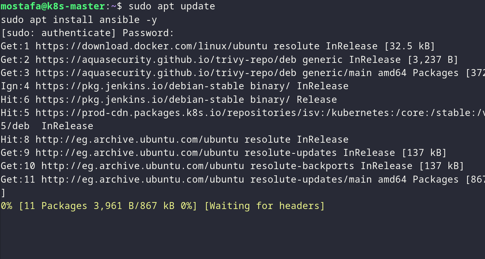
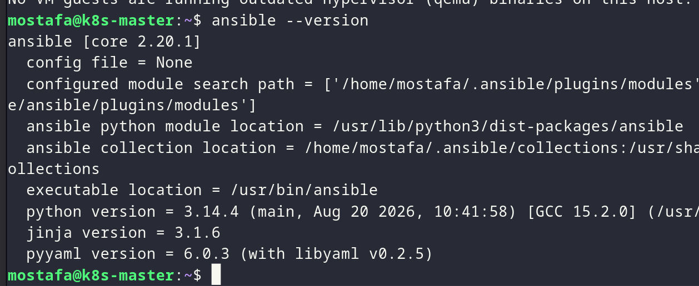
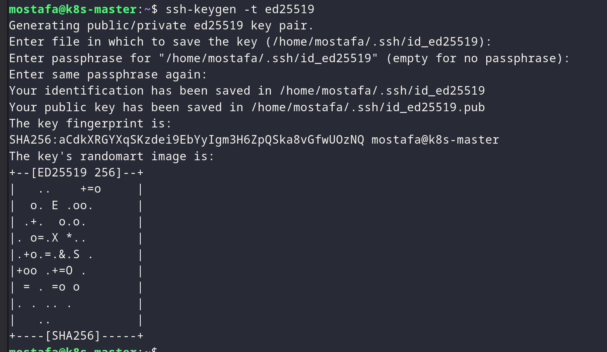
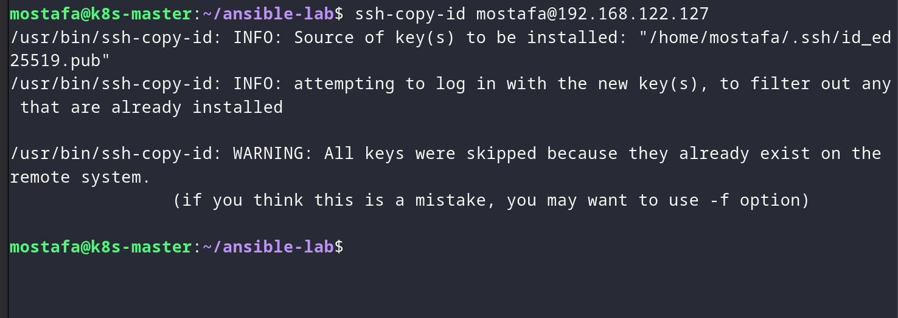
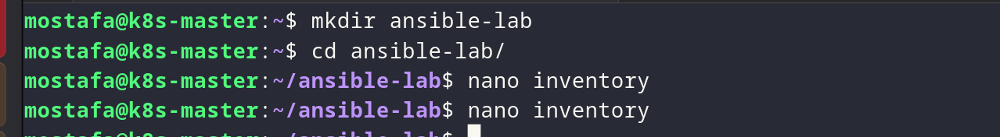
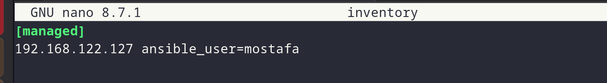
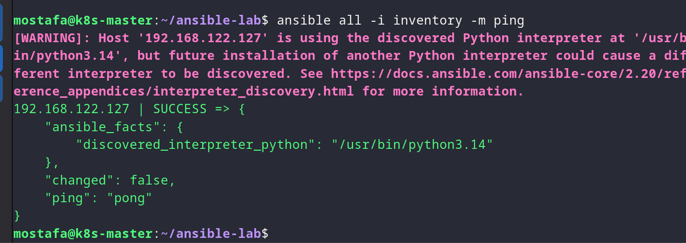
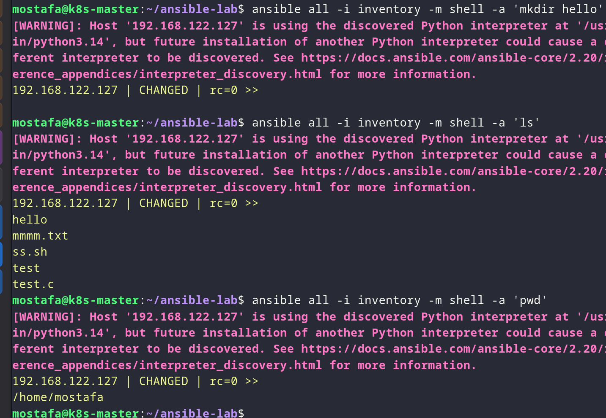

# Lab 24 - Ansible Setup

## Overview

Use Ansible playbooks to install and configure the Docker, Kubernetes and Jenkins components on the managed hosts.

## Proof

### 1. Before running the playbook

*Reviewing the playbook before execution.*

*Reviewing the playbook tasks before execution.*

### 2. Run the playbook

*Running the Ansible playbook against the managed hosts.*

*Executing the playbook tasks.*

*Waiting for the playbook to complete.*

*Verifying the playbook results.*

### 3. Verify the installation

*Confirming the installation.*

*Verifying the setup status.*
