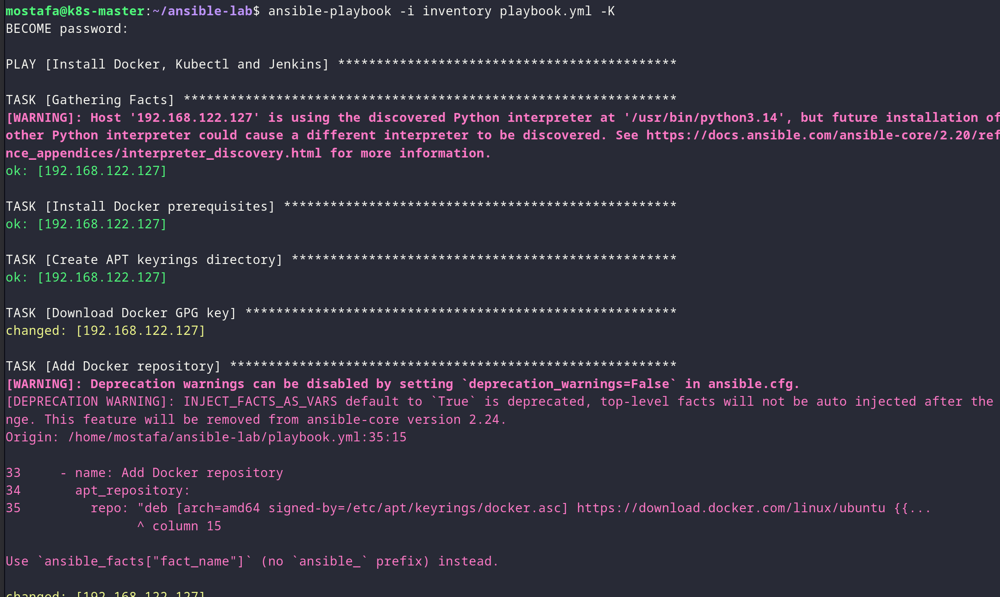
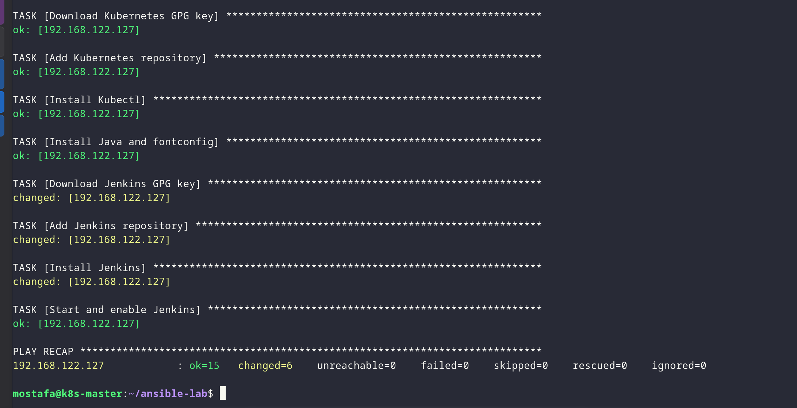

# Lab 25 - Install Docker, Kubectl and Jenkins with Ansible

## Overview

Use an Ansible playbook to install Docker, Kubernetes and Jenkins on the managed host.

## Proof

### 1. Review the playbook

```yaml
---
- name: Install Docker, Kubectl and Jenkins
  hosts: managed
  become: yes

  tasks:

    # -------------------------
    # 1. Install Docker
    # -------------------------

    - name: Install Docker prerequisites
      apt:
        name:
          - ca-certificates
          - curl
          - gnupg
        state: present
        update_cache: yes

    - name: Create APT keyrings directory
      file:
        path: /etc/apt/keyrings
        state: directory
        mode: '0755'

    - name: Download Docker GPG key
      get_url:
        url: https://download.docker.com/linux/ubuntu/gpg
        dest: /etc/apt/keyrings/docker.asc
        mode: '0644'

    - name: Add Docker repository
      apt_repository:
        repo: "deb [arch=amd64 signed-by=/etc/apt/keyrings/docker.asc] https://download.docker.com/linux/ubuntu {{ ansible_distribution_release }} stable"
        filename: docker
        state: present
        update_cache: yes

    - name: Install Docker
      apt:
        name:
          - docker-ce
          - docker-ce-cli
          - containerd.io
          - docker-buildx-plugin
          - docker-compose-plugin
        state: present
        update_cache: yes

    - name: Start and enable Docker
      service:
        name: docker
        state: started
        enabled: yes

    # -------------------------
    # 2. Install Kubectl
    # -------------------------

    - name: Download Kubernetes GPG key
      shell: |
        curl -fsSL https://pkgs.k8s.io/core:/stable:/v1.35/deb/Release.key |
        gpg --dearmor -o /etc/apt/keyrings/kubernetes-apt-keyring.gpg
      args:
        creates: /etc/apt/keyrings/kubernetes-apt-keyring.gpg

    - name: Add Kubernetes repository
      apt_repository:
        repo: "deb [signed-by=/etc/apt/keyrings/kubernetes-apt-keyring.gpg] https://pkgs.k8s.io/core:/stable:/v1.35/deb/ /"
        filename: kubernetes
        state: present
        update_cache: yes

    - name: Install Kubectl
      apt:
        name: kubectl
        state: present
        update_cache: yes

    # -------------------------
    # 3. Install Jenkins
    # -------------------------

    - name: Install Java and fontconfig
      apt:
        name:
          - fontconfig
          - openjdk-21-jre
        state: present
        update_cache: yes

    - name: Download Jenkins GPG key
      get_url:
        url: https://pkg.jenkins.io/debian-stable/jenkins.io-2026.key
        dest: /etc/apt/keyrings/jenkins-keyring.asc
        mode: '0644'

    - name: Add Jenkins repository
      apt_repository:
        repo: "deb [signed-by=/etc/apt/keyrings/jenkins-keyring.asc] https://pkg.jenkins.io/debian-stable binary/"
        filename: jenkins
        state: present
        update_cache: yes

    - name: Install Jenkins
      apt:
        name: jenkins
        state: present
        update_cache: yes

    - name: Start and enable Jenkins
      service:
        name: jenkins
        state: started
        enabled: yes
```

### 2. Run the playbook



*Running the Ansible playbook to install Docker, Kubectl and Jenkins.*



*Waiting for the installation to complete.*
