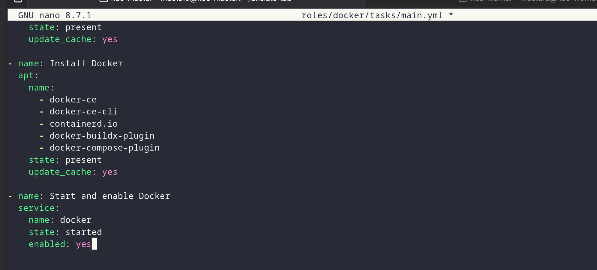
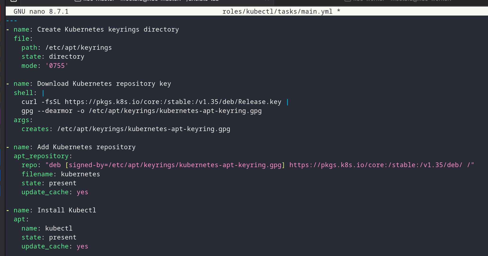
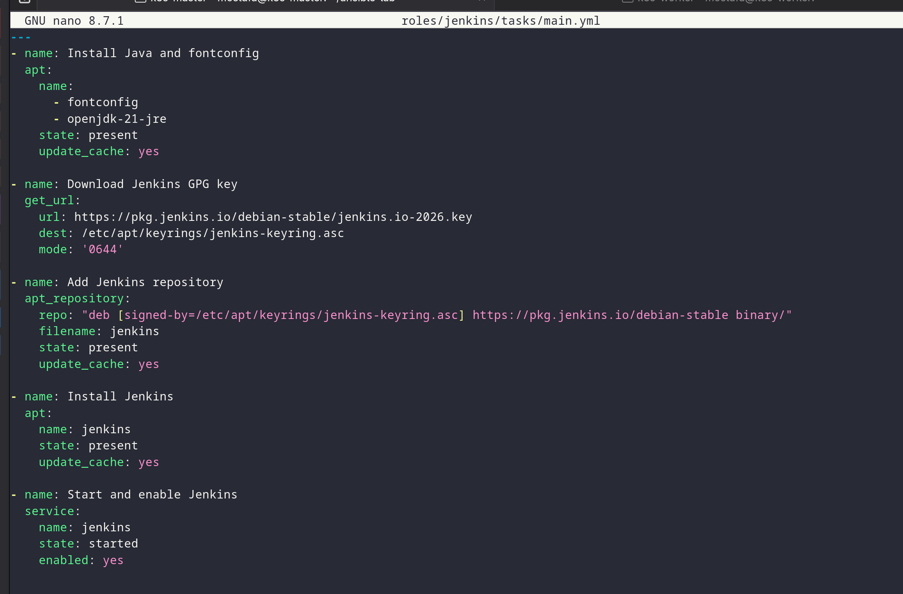
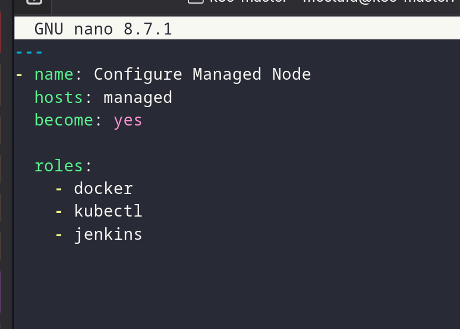
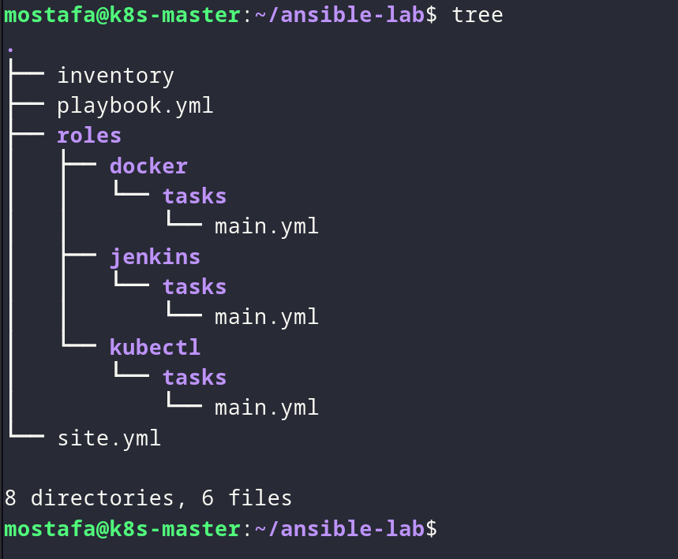
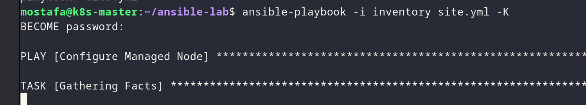
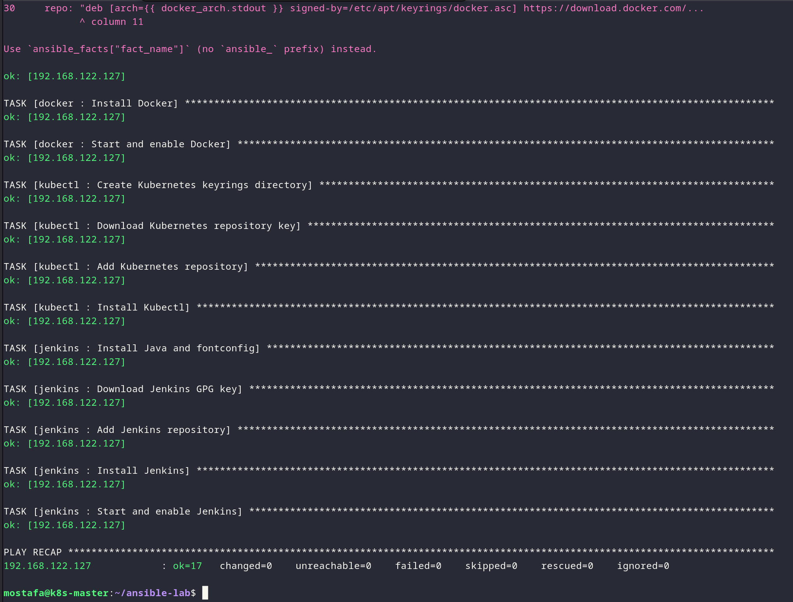

# Lab 26 - Ansible Roles for Cluster Setup

## Overview

Organize the Ansible setup into reusable roles for Docker, Kubernetes and Jenkins under the `roles/` directory.

## Proof

### 1. Review the Ansible structure

```sh
ansible-lab/
│
├── inventory
├── site.yml
│
└── roles/
    ├── docker/
    │   └── tasks/
    │       └── main.yml
    │
    ├── kubectl/
    │   └── tasks/
    │       └── main.yml
    │
    └── jenkins/
        └── tasks/
            └── main.yml
```

### 2. Review the roles



*Reviewing the Ansible directory structure.*



*Reviewing the Docker role tasks.*



*Reviewing the Kubernetes role tasks.*

### 3. Run the playbook



*Running the playbook with the new roles.*



*Waiting for the playbook to complete.*



*Verifying the playbook results.*



*Confirming the setup status.*
