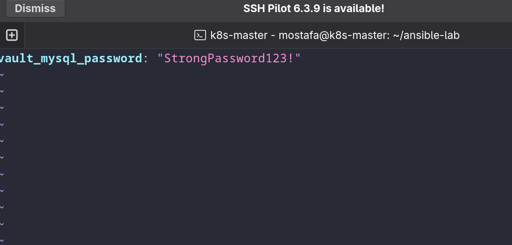
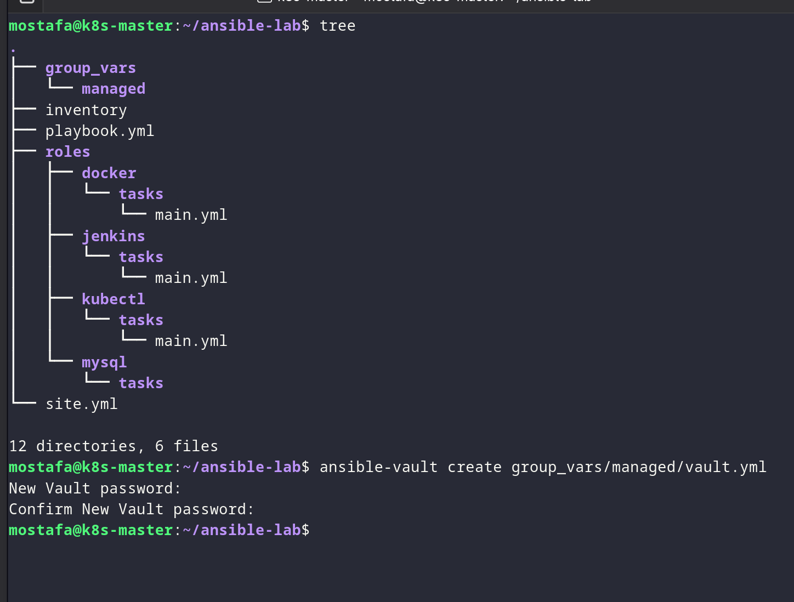
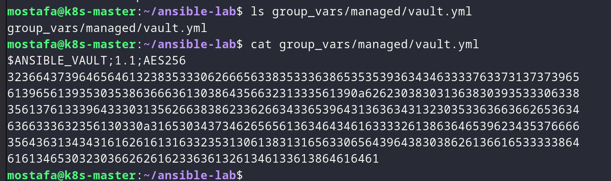
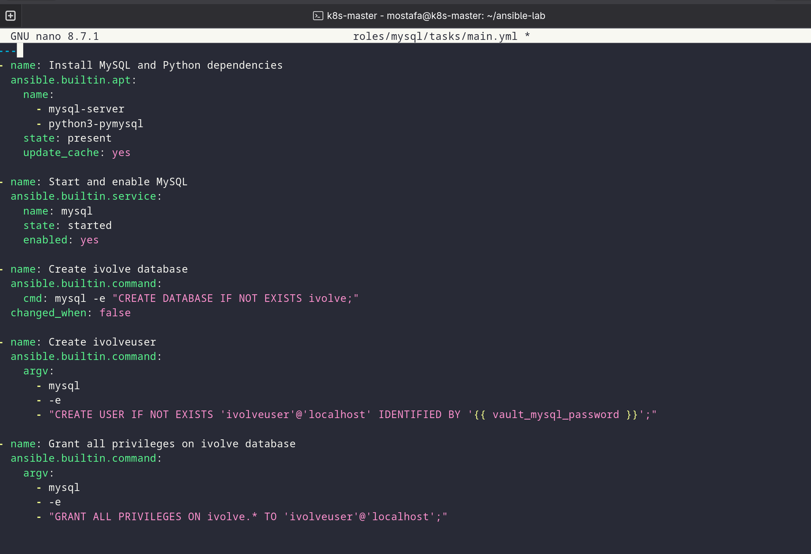
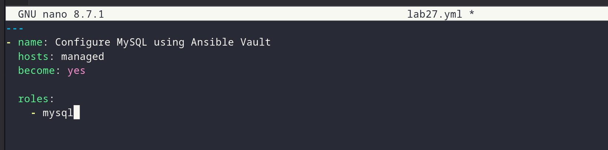
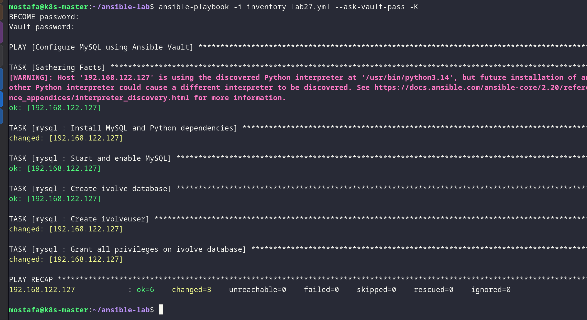
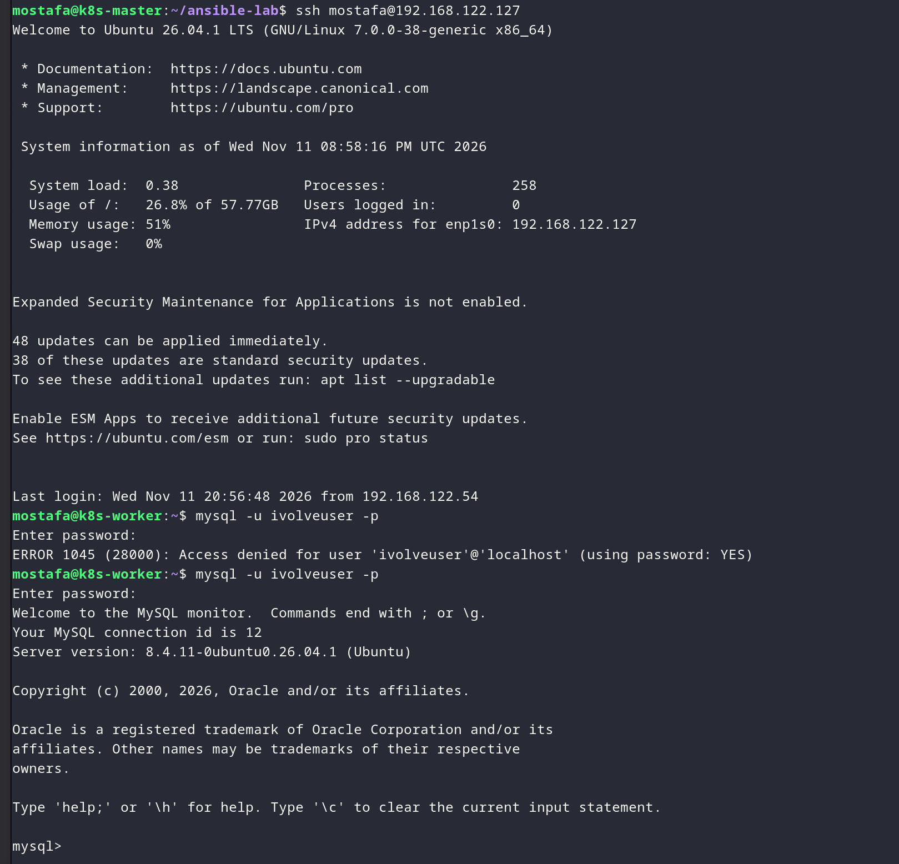

# Lab 27 - Ansible Playbook on EC2

## Overview

Run the Ansible playbook against the AWS EC2 host to install and configure the lab services.

## Proof

### 1. Before running the playbook

*Reviewing the EC2 host before running the playbook.*

*Reviewing the Ansible setup before execution.*

### 2. Run the playbook

*Running the Ansible playbook against the EC2 host.*

*Waiting for the playbook to complete.*

*Executing the playbook tasks.*

*Verifying the playbook results.*

### 3. Verify the setup

*Confirming the setup status.*

*Checking the installed services.*
