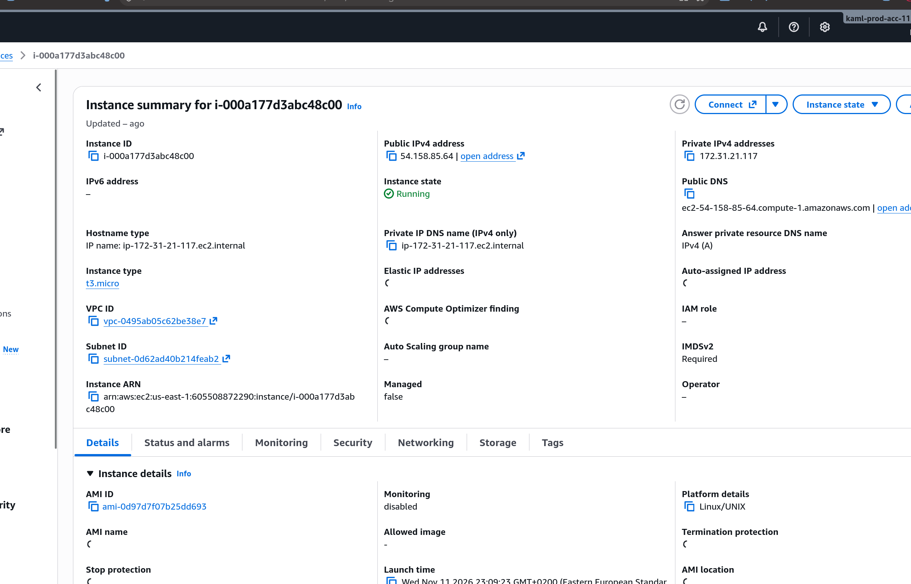
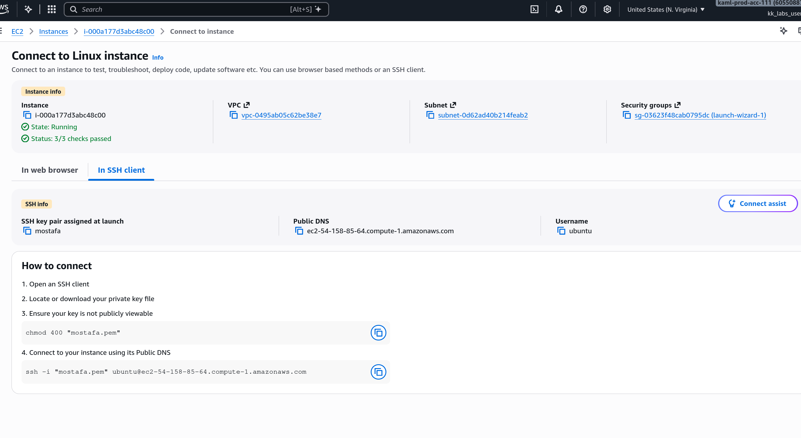
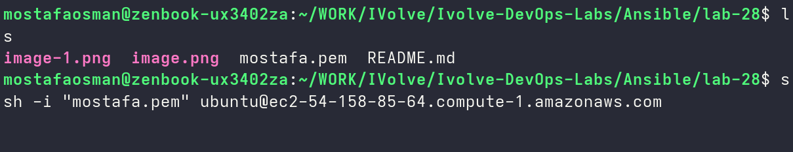
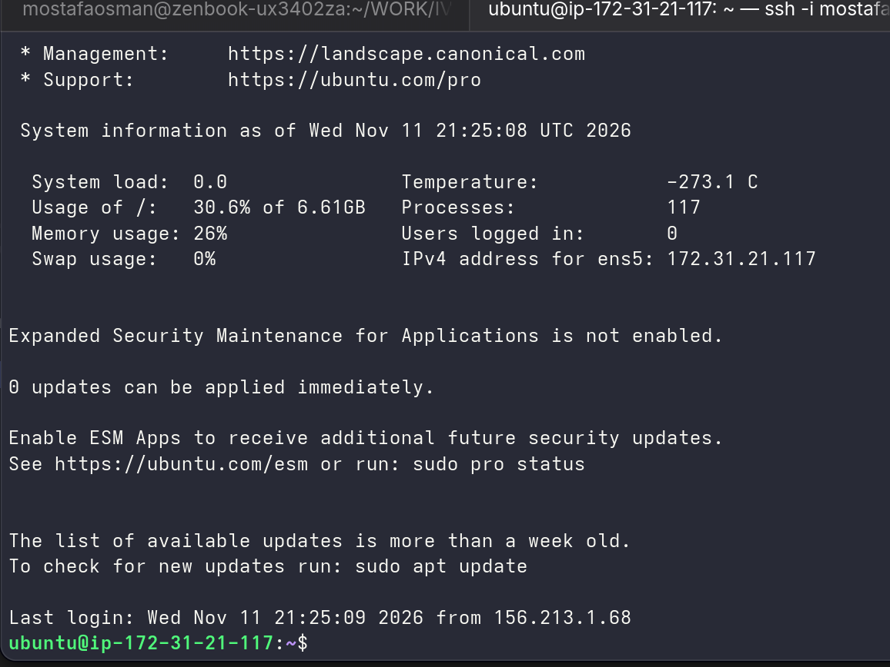
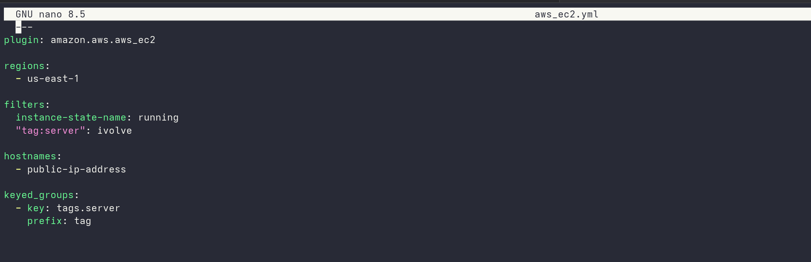
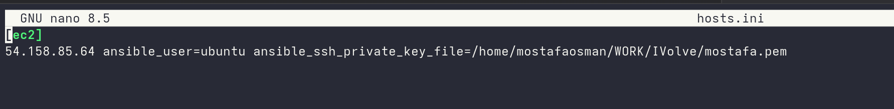
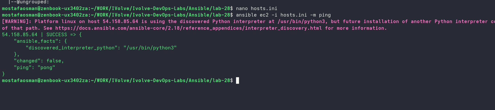

# Lab 28 - AWS EC2 with Ansible

## Overview

Use the Amazon AWS EC2 dynamic inventory plugin in Ansible to automatically discover and manage the running EC2 instances for the lab.

## Proof

### 1. Review the EC2 dynamic inventory

```yaml
---
plugin: amazon.aws.aws_ec2

regions:
  - us-east-1

filters:
  instance-state-name: running
  "tag:server": ivolve

hostnames:
  - public-ip-address

keyed_groups:
  - key: tags.server
    prefix: tag
```

### 2. Review the Ansible hosts inventory

```ini
[ec2]
54.158.85.64 ansible_user=ubuntu ansible_ssh_private_key_file=/home/mostafaosman/WORK/mostafa.pem
```

### 3. Run the playbook



*Running the Ansible playbook against the discovered EC2 host.*



*Waiting for the playbook to complete.*



*Executing the playbook tasks.*



*Verifying the playbook results.*

### 4. Verify the setup



*Confirming the setup status.*



*Verifying the playbook results.*



*Confirming the deployment status.*
