# Lab 23 - ArgoCD GitOps Deployment

## Overview

Reconfigure the Jenkins shared library and pipeline so that after a Docker image is pushed, it updates the GitOps repository, and ArgoCD reconciles and deploys the new image to the cluster.

## Proof

### 1. Before pipeline

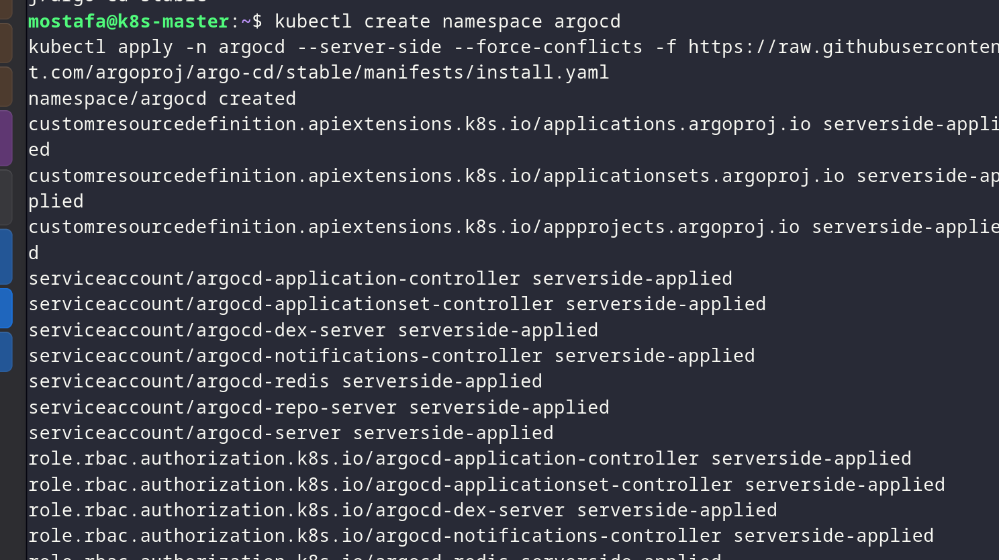

*Checking the GitOps setup before running the pipeline.*

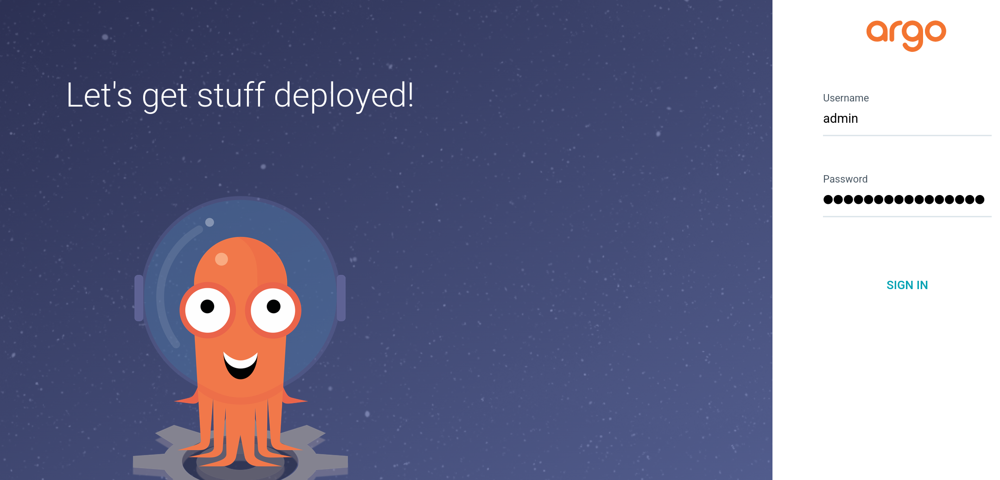

*Reviewing the Jenkins job before the pipeline runs.*

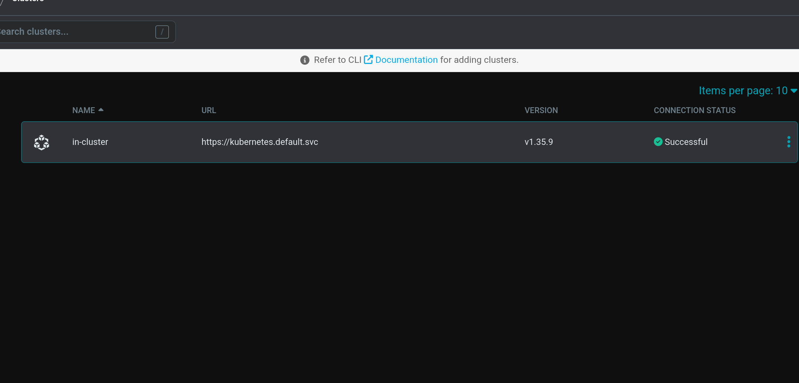

*Reviewing the pipeline configuration before execution.*

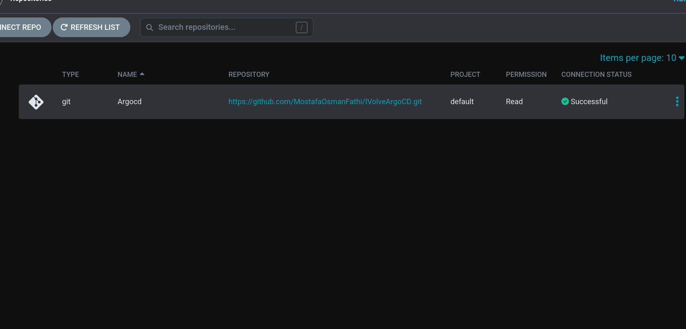

*Reviewing the shared library setup before execution.*

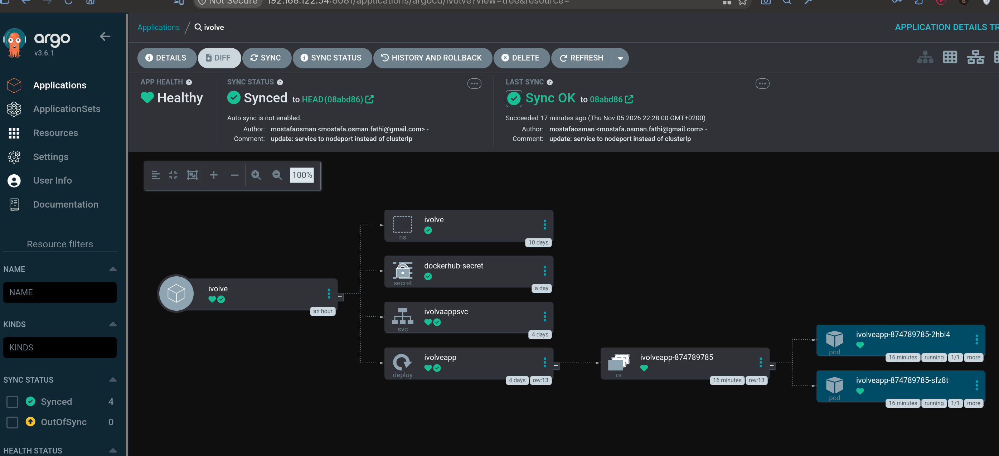

*Reviewing the shared library variables before execution.*

### 2. Reconfigure the Jenkins shared library and pipeline for ArgoCD

## Jenkins Shared Library

### `vars/updateArgoCD.groovy`

```groovy
// Shared library step: updateArgoCD
// After an image has been pushed, this step updates the image tag in the
// GitOps repository (IVolveArgoCD) and pushes the change, so ArgoCD can
// reconcile the new image into the cluster.
//
// Usage:
//   updateArgoCD()
//   updateArgoCD(image: 'org/app', tag: env.BUILD_NUMBER, gitCredentialsId: 'Github')
def call(Map config = [:]) {
    def image = config.image ?: env.DOCKER_IMAGE ?: 'mostafaosmanfathi/ivolve-nodejs-app'
    def tag = config.tag ?: env.BUILD_NUMBER ?: 'latest'
    def fullImage = "${image}:${tag}"
    def gitOpsRepoUrl = config.gitOpsRepoUrl ?: 'https://github.com/MostafaOsmanFathi/IVolveArgoCD.git'
    def gitOpsBranch = config.gitOpsBranch ?: 'main'
    def manifestPath = config.manifestPath ?: 'ArgoCD/deployment.yaml'
    def gitCredentialsId = config.gitCredentialsId ?: 'Github'
    def workDir = config.workDir ?: "ivolve-argocd-${tag}"

    echo "======== Update GitOps manifest for ArgoCD ========"
    sh "rm -rf ${workDir}"

    def repoPath = gitOpsRepoUrl.replace('https://', '')

    withCredentials([
        usernamePassword(
            credentialsId: gitCredentialsId,
            usernameVariable: 'GIT_USERNAME',
            passwordVariable: 'GIT_PASSWORD'
        )
    ]) {
        sh "git clone https://\${GIT_USERNAME}:\${GIT_PASSWORD}@${repoPath} ${workDir}"
    }

    sh "sed -i 's|${image}:.*|${fullImage}|' ${workDir}/${manifestPath}"

    withCredentials([
        usernamePassword(
            credentialsId: gitCredentialsId,
            usernameVariable: 'GIT_USERNAME',
            passwordVariable: 'GIT_PASSWORD'
        )
    ]) {
        sh """
        cd ${workDir}
        git config user.email "jenkins@ivolve.local"
        git config user.name "Jenkins"
        git add ${manifestPath}
        git commit -m "chore: update image to ${fullImage}" || echo "No changes to commit"
        git push https://\${GIT_USERNAME}:\${GIT_PASSWORD}@${repoPath} ${gitOpsBranch}
        """
    }

    sh "rm -rf ${workDir}"
    echo "GitOps manifest updated to ${fullImage}; ArgoCD will reconcile."
}
```

## Jenkins Pipeline

### New Jenkinsfile

```groovy
@Library('jenkins-shared-lib') _

pipeline {
    agent any

    environment {
        DOCKER_IMAGE = 'mostafaosmanfathi/ivolve-nodejs-app'
    }

    stages {
        stage('Build app') {
            steps {
                buildApp()
            }
        }

        stage('Build and push image') {
            steps {
                buildAndPushImage()
            }
        }

        stage('Update GitOps manifest') {
            steps {
                updateArgoCD()
            }
        }
    }

    post {
        success {
            echo 'Pipeline completed successfully.'
        }
        failure {
            echo '======== pipeline execution failed ========'
        }
    }
}
```

### 3. Run the fully automated pipeline

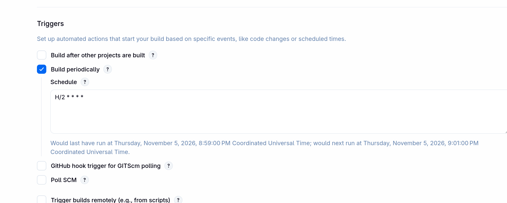

*Starting the Jenkins pipeline for the ArgoCD update.*

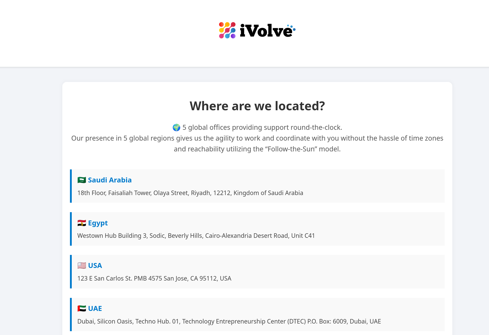

*Running the build stage.*

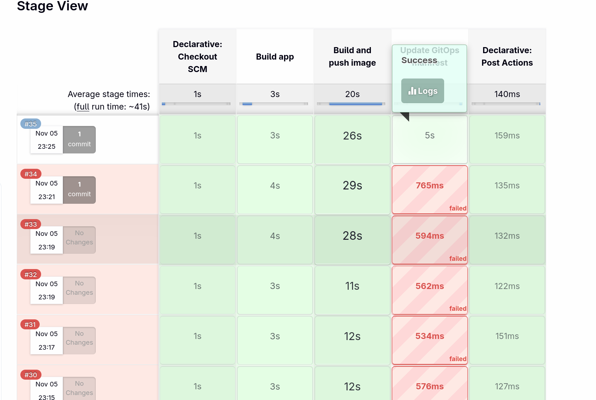

*Running the Docker image build stage.*

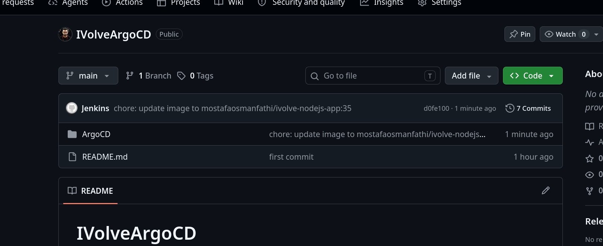

*Running the Docker image push stage.*

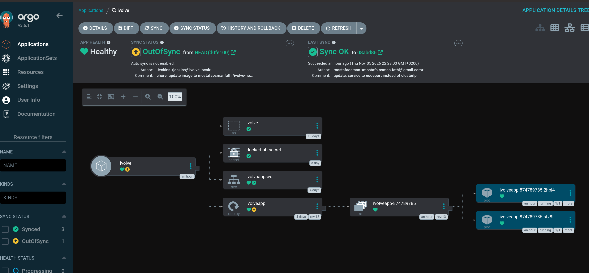

*Running the GitOps manifest update stage.*

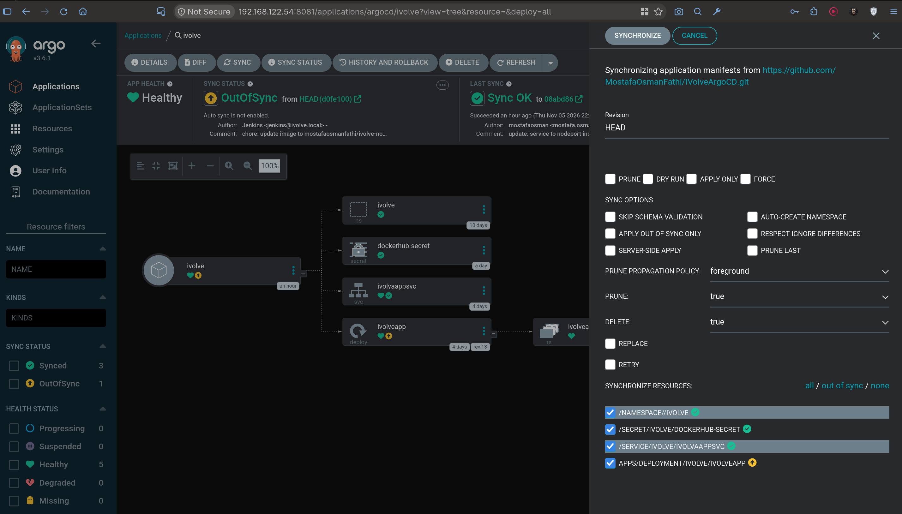

*Running the ArgoCD reconciliation stage.*

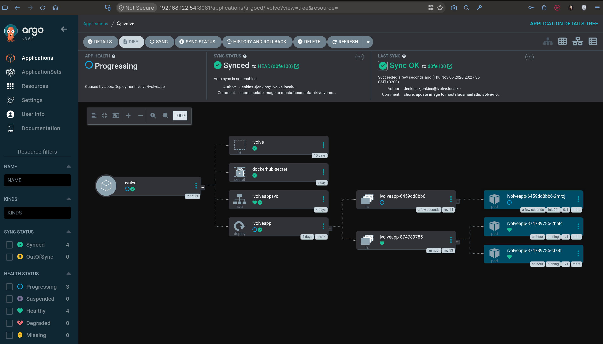

*Waiting for the ArgoCD deployment rollout.*

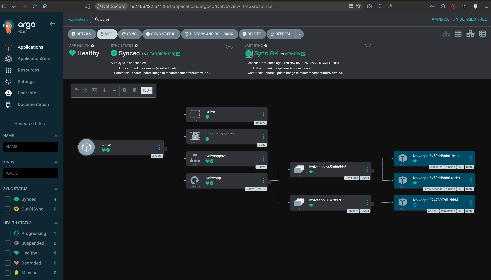

*Completing the pipeline stage.*

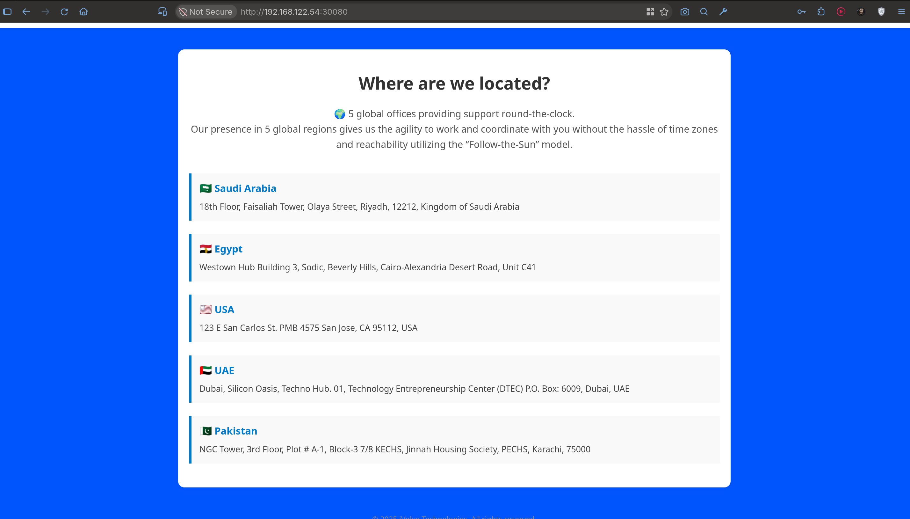

*Confirming the pipeline result.*

### 4. Testing the fully automated pipeline

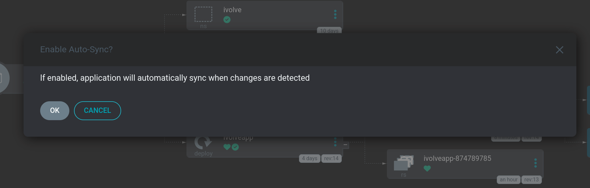

*Checking the pipeline settings for the fully automated test.*

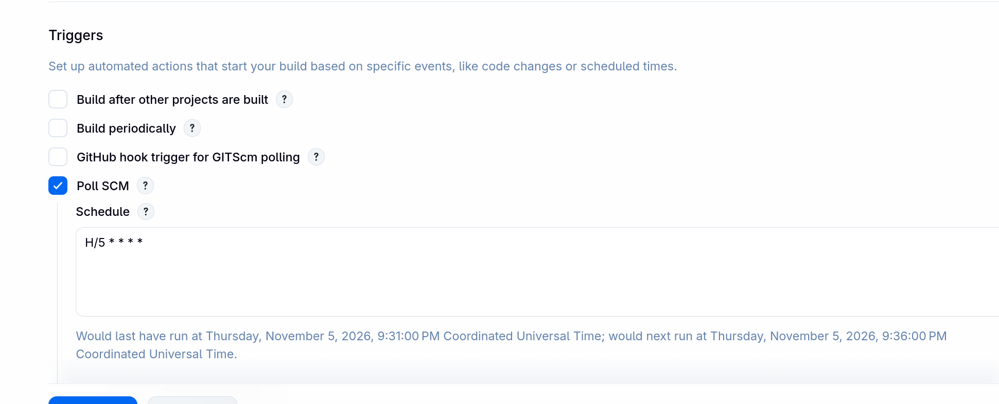

*Reviewing the pipeline settings before running the test.*

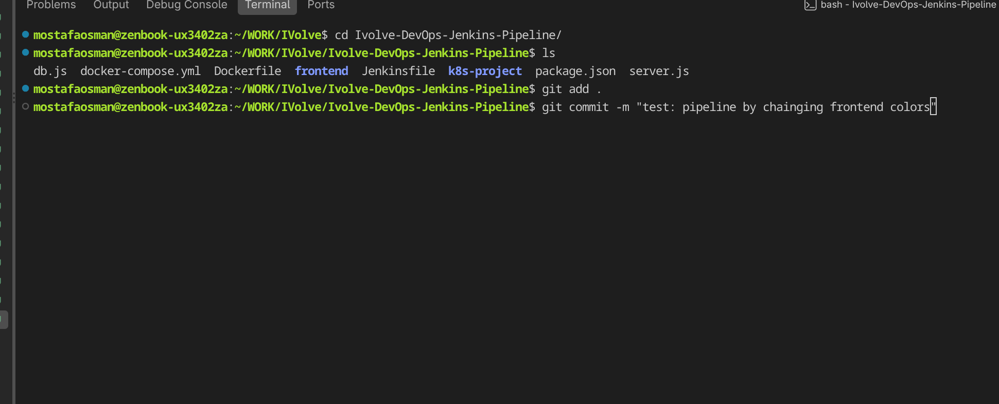

*Running the fully automated pipeline test.*

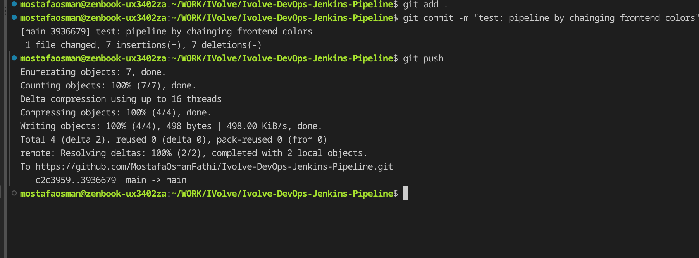

*Running the automated pipeline test stages.*

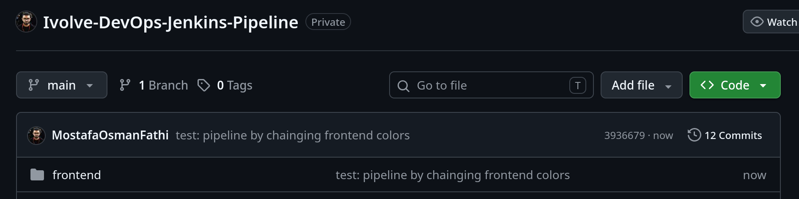

*Confirming the ArgoCD deployment after the automated run.*

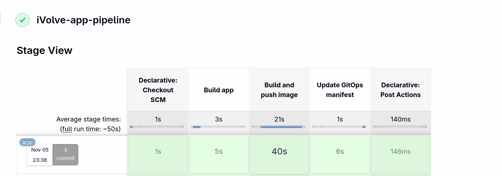

*Verifying the updated ArgoCD deployment.*

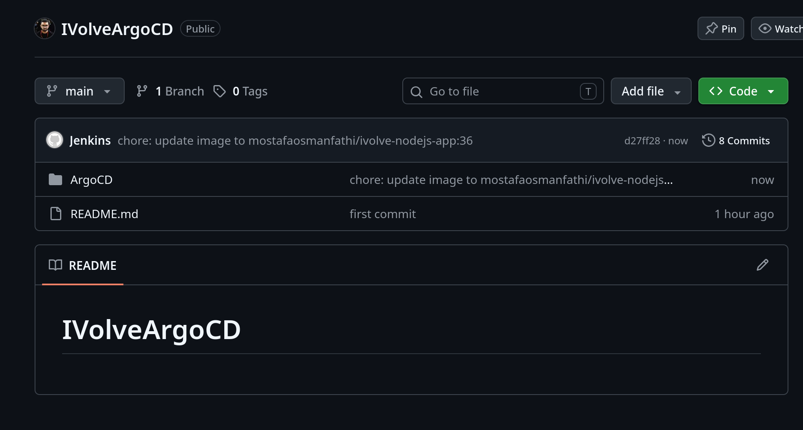

*Verifying the deployed application.*

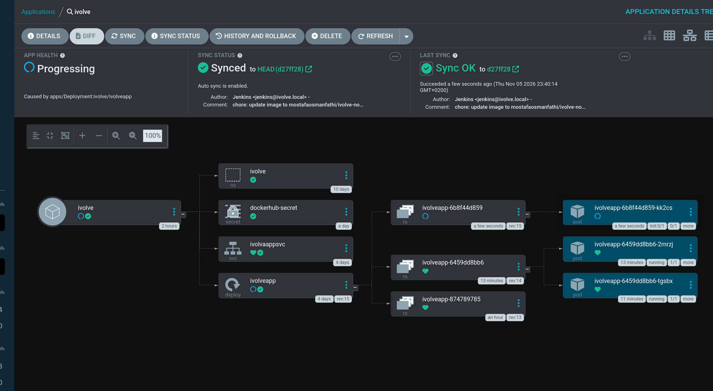

*Verifying the ArgoCD sync status.*

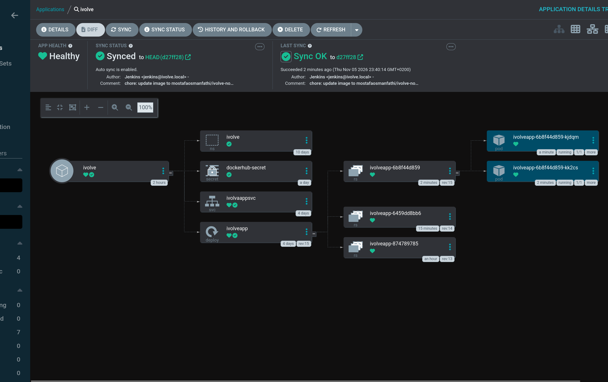

*Confirming the rollout completed.*

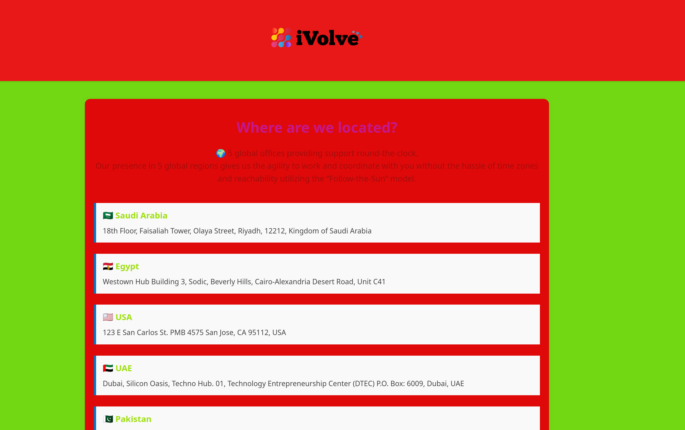

*Confirming the fully automated pipeline test finished successfully.*
