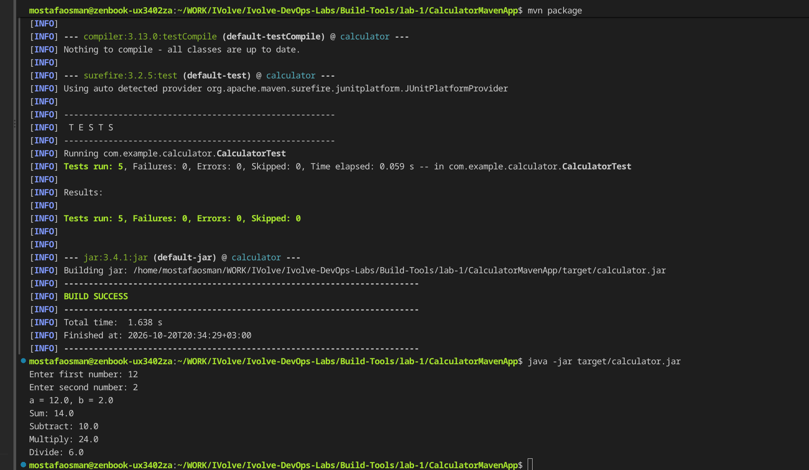

# Build Tools Lab 1 - Maven

## Overview

`CalculatorMavenApp` is a Maven project. It is built, tested, and packaged with Maven, then run from the produced jar.

## Proof

### 1. Build, test and run

`mvn package` prints `BUILD SUCCESS` and runs 5 tests with 0 failures, then `java -jar target/calculator.jar` with inputs `12` and `2` (Sum 14, Subtract 10, Multiply 24, Divide 6).

### 2. Run the tests

`mvn test` runs 5 tests with 0 failures and 0 errors.

