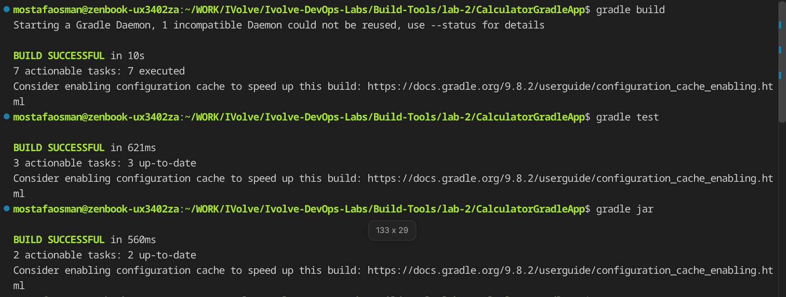

# Build Tools Lab 2 - Gradle

## Overview

`CalculatorGradleApp` is a Gradle project. It is built, tested, and packaged with Gradle, then run from the produced jar.

## Proof

### 1. Build, test and package

`gradle build`, `gradle test`, and `gradle jar` all report `BUILD SUCCESSFUL`.

### 2. Run the jar

`java -jar build/libs/calculator.jar` with inputs `12` and `2` (Sum 14, Subtract 10, Multiply 24, Divide 6).

