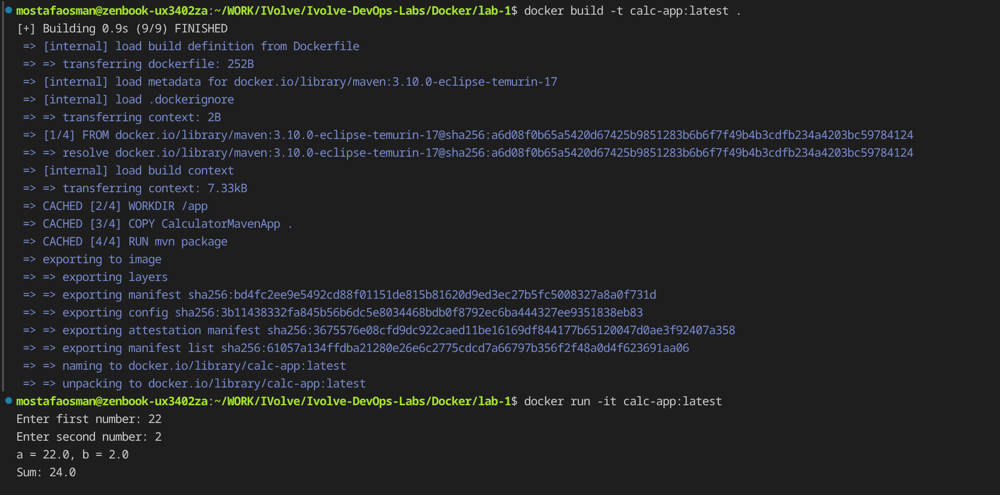

# Lab 1 - Dockerizing a Maven Application

## Overview

Single-stage build. The `Dockerfile` uses the Maven image, builds the calculator inside the image, and runs the produced jar.

```dockerfile
FROM maven:3.10.0-eclipse-temurin-17
WORKDIR /app
COPY CalculatorMavenApp .
RUN mvn package
CMD ["java", "-jar", "target/calculator.jar"]
EXPOSE 8080
```

## Proof

### Build and run

`docker build -t calc-app:latest .` finishes successfully, then `docker run -it calc-app:latest` with inputs `22` and `2` prints `Sum: 24.0`.



### Image size

`docker image ls | grep calc` shows `calc-app:latest` at 857MB (266MB compressed).


