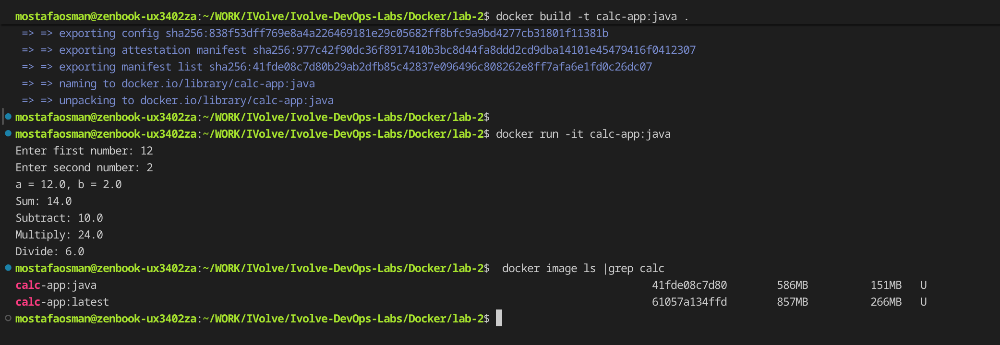

# Lab 2 - Bonus: Why `calc-app:java` is smaller

```text
$ docker image ls | grep calc
calc-app:java      41fde08c7d80   586MB   151MB   U
calc-app:latest    61057a134ffd   857MB   266MB   U
```

`calc-app:java` is smaller than `calc-app:latest` because it only contains the built `.jar` file and nothing else. `calc-app:latest` is built from the Maven image, so it also carries the application source code, the compiled `.class` files, and all build dependencies.

## Proof

`docker build -t calc-app:java .`, then `docker run -it calc-app:java` (inputs `12` and `2`), then `docker image ls | grep calc` showing both images side by side.


