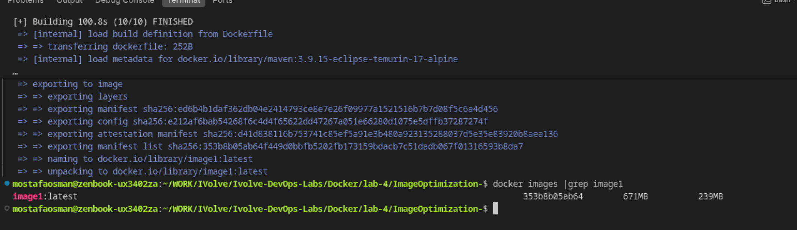
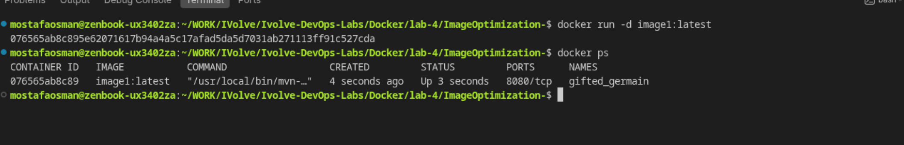

# Lab 4 - Image Optimization

## Overview

Single-stage vs multi-stage build. `image1` is built from the Maven image and keeps the whole build environment. `image2` is a multi-stage build that keeps only the jar on a slim JRE and runs as a non-root user.

## Proof

### 1. Build `image1` (single-stage)

`docker images` shows `image1:latest` at 671MB (239MB compressed).

### 2. Run `image1`

`docker run -d image1:latest` starts a container listening on port 8080.

### 3. Run with an explicit name

`docker run -d --name container1 image1:latest` starts `container1`.

### 4. Stop and remove

`docker stop container1` then `docker rm container1`.

### 5. Build `image2` (multi-stage) and compare

`image1` is 671MB while `image2` is 304MB (88.2MB compressed).

### 6. Non-root user

`docker exec -it container2 sh`, then `whoami` returns `runner` and `id runner` shows uid=100, confirming the container runs as non-root.

### 7. Save, remove and load the image

`docker save image2:latest -o lab-image.tar`, then `docker rmi image2:latest`, then `docker load -i ./lab-image.tar`.

### 8. Image restored

`docker images | grep image2` shows `image2:latest` back after the load.

