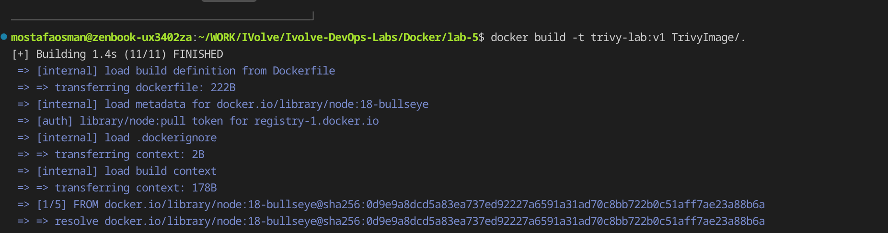
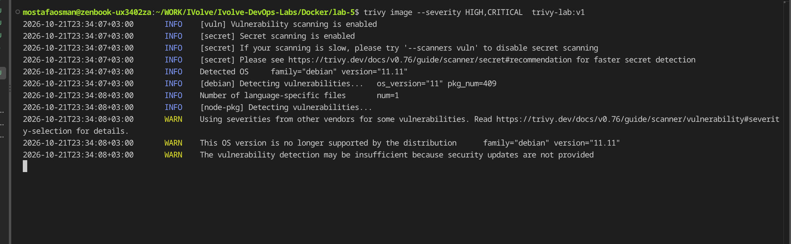
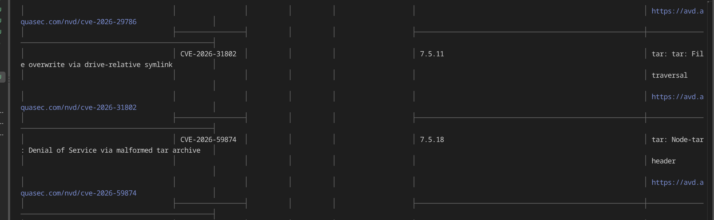
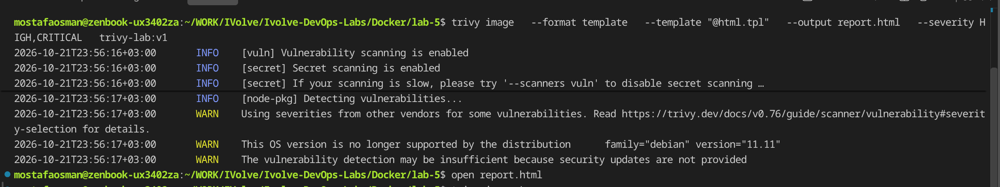
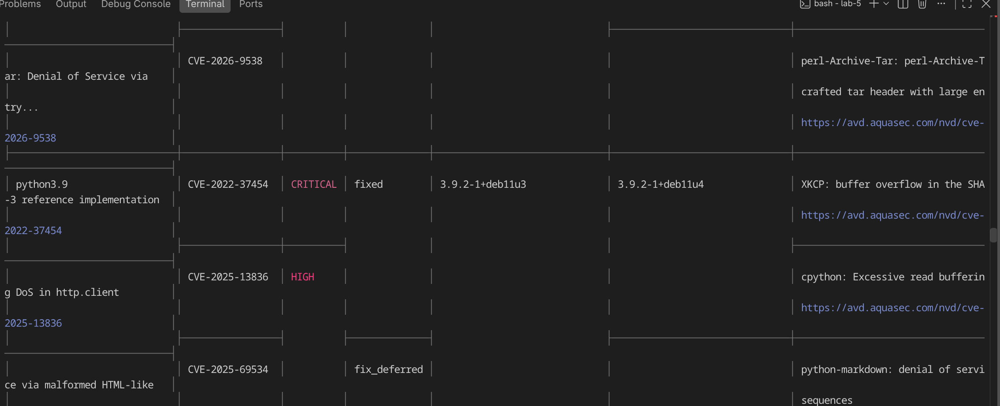
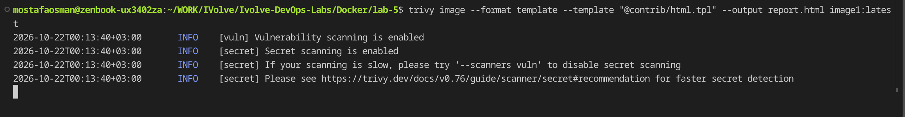
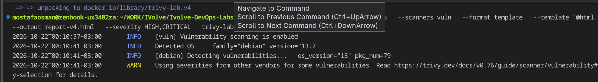
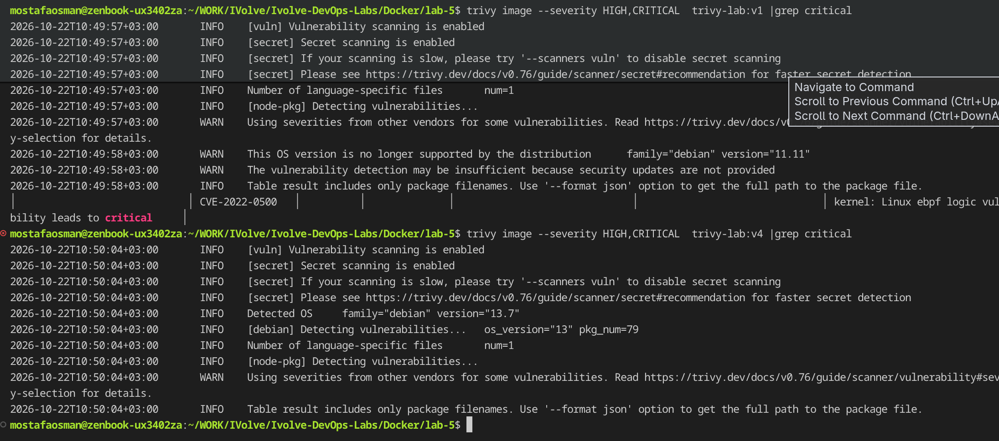

    

the reason behind all these vulernablies was old base image which has lot's of unbatched securty leacks updated base image to newer version 

changed base image and all critical issue dissabeared

