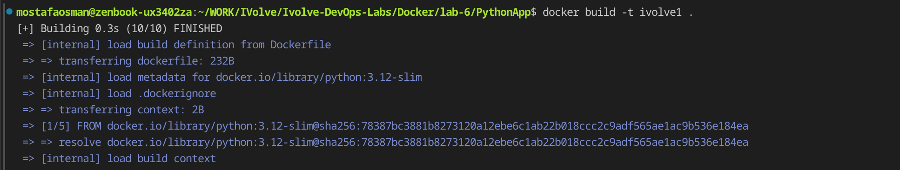
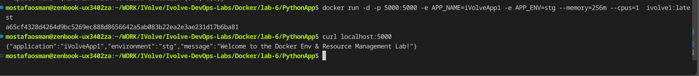
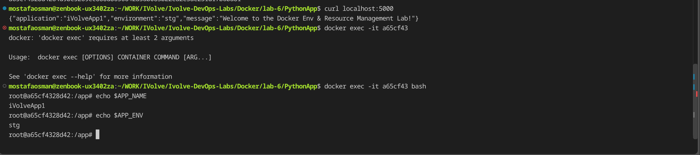
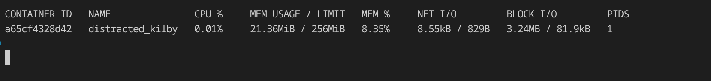
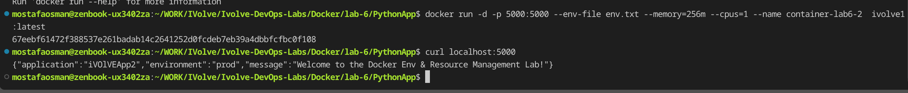
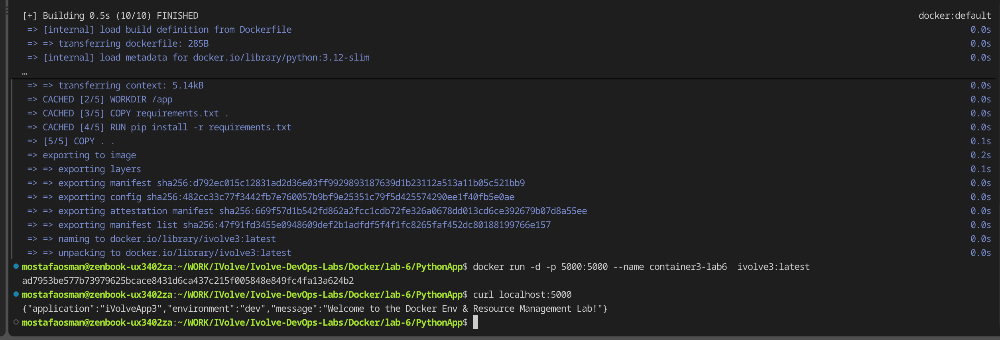

# Lab 6 - Environment Variables and Resource Limits

## Overview

Flask app (`PythonApp`) that reads `APP_NAME` and `APP_ENV` and refuses to start if either is missing. The container is run with memory and CPU limits, and the variables are supplied three different ways: `-e`, `--env-file`, and Dockerfile `ENV` defaults.

## Proof

### 1. Build the image

`docker build -t ivolve1 .` builds from `python:3.12-slim`.

### 2. Run with `-e` and resource limits

`docker run -d -p 5000:5000 -e APP_NAME=iVolveApp1 -e APP_ENV=stg --memory=256m --cpus=1 ivolve1:latest`; `curl localhost:5000` returns `iVolveApp1` / `stg`.

### 3. Check the variables inside the container

`docker exec -it <id> bash`; `$APP_NAME` = `iVolveApp1` and `$APP_ENV` = `stg`.

### 4. Resource usage

`docker stats` shows the container capped at 256MiB and 1 CPU.

### 5. Run with `--env-file`

`docker run ... --env-file env.txt ...`; `curl localhost:5000` returns `iVOlVEApp2` / `prod`.

### 6. Run with Dockerfile defaults

`docker build -t ivolve3 .` then run with no env flags; `curl localhost:5000` returns the Dockerfile defaults `iVolveApp3` / `dev`.

