# Lab 7 - Microservices with Custom Networks and Volumes

## Overview

Three services (frontend, backend, notification) built as separate images and connected with two bridge networks. The backend and notification use named volumes for their logs, and the backend also bind-mounts `bind-vol` for its data file. Service details are in `MicroserviceApp/README.md`.

## Proof

### 1. Build the frontend

`docker build -t frontend frontend/.`

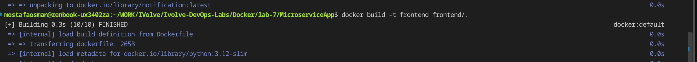

### 2. Build the notification service

`docker build -t notification notification/.`

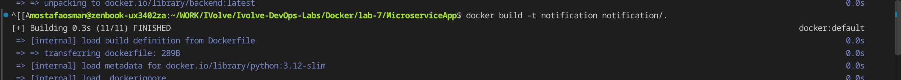

### 3. Build the backend

`docker build -t backend backend/.`

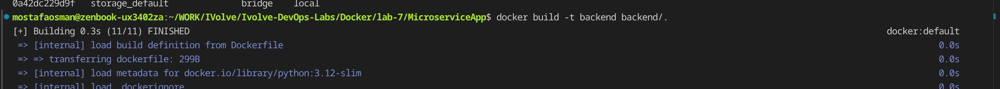

### 4. Create the two networks

`docker network create --driver bridge --subnet 192.168.15.0/24 frontend-backend` and `docker network create --driver bridge --subnet 192.168.16.0/24 backend-notification`.

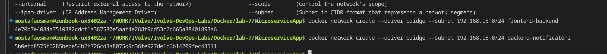

### 5. Create the log volumes

`docker volume create backend-logs` and `docker volume create notification-logs`.

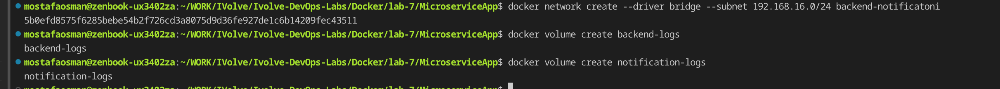

### 6. Run the backend and connect both networks

`docker run -d -v backend-logs:/app/logs/ --network frontend-backend backend:latest`, then `docker network connect backend-notification <id>`.

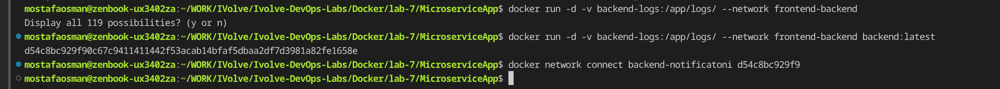

### 7. Run backend with a bind mount

Backend run with `-v backend-logs:/app/logs/ -v "$(pwd)/bind-vol/:/app/data/" --name backend`, then connected to the notification network.

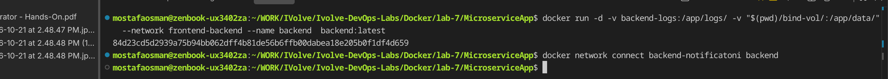

### 8. Run the notification service

`docker run -d -v notification-logs:/app/logs/ --network backend-notification --name notification notification:latest`.

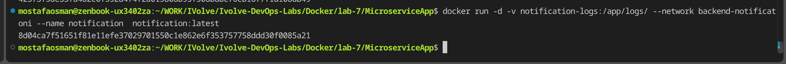

### 9. Run the frontend and check containers

`docker run -d --network frontend-backend -p 8080:3000 --name frontend frontend:latest`; `docker ps` shows frontend on `8080->3000`, backend on 5000, and notification on 5001.

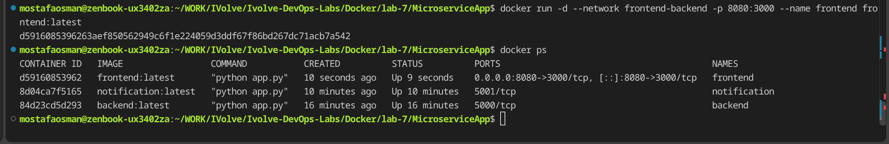

### 10. The running app

The frontend page in the browser shows the stored messages (`11`, `mostafa osman`).

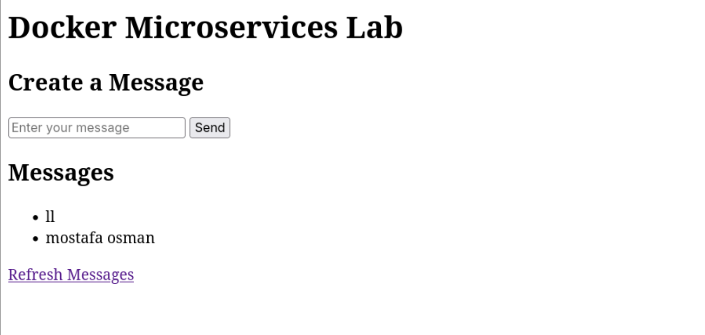

### 11. Data persisted to the host

`bind-vol/messages.json` on the host contains `["11", "mostafa osman"]`, confirming the data persisted through the bind mount.

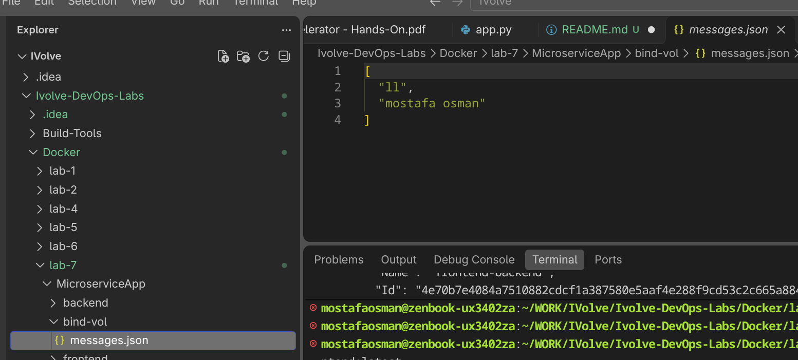
