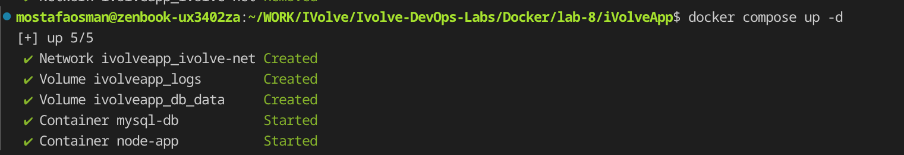
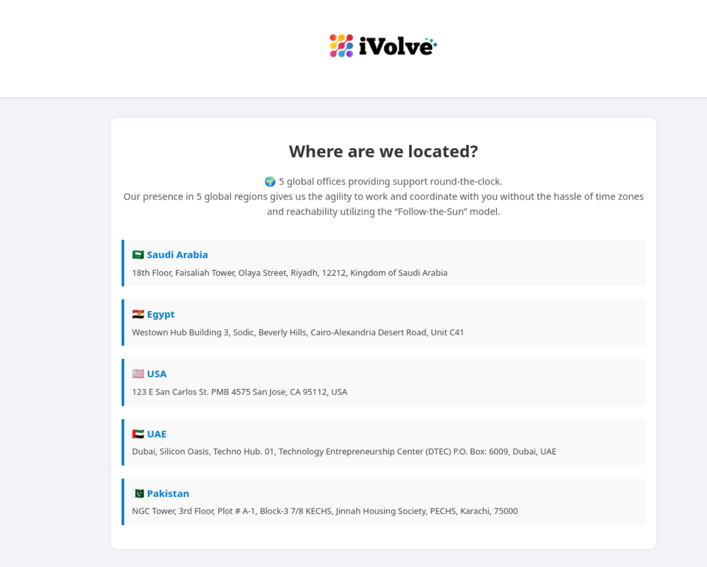
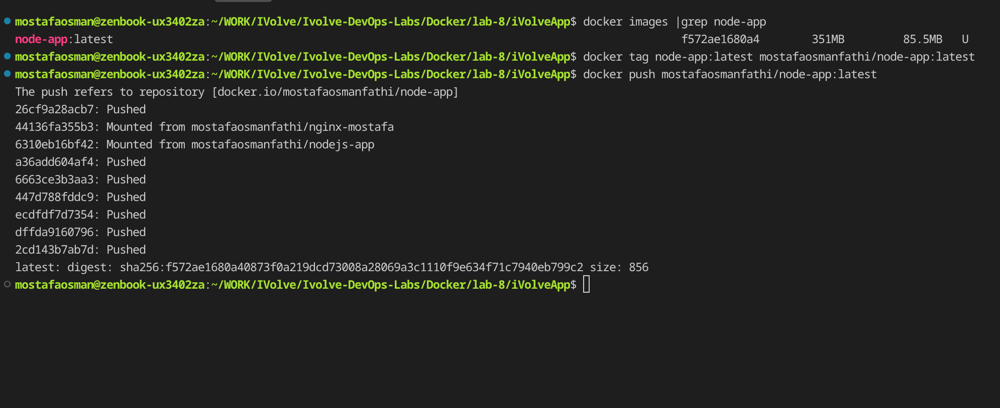
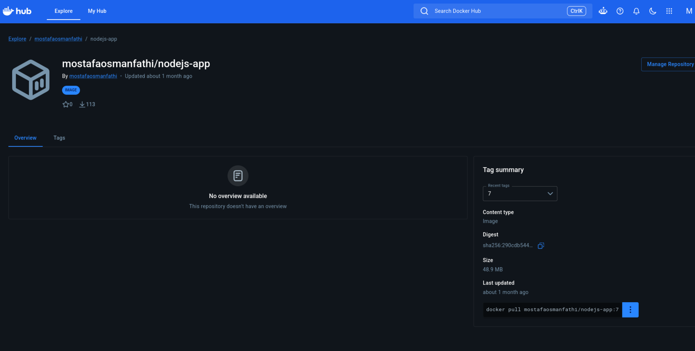

# Lab 8 - Multi-Container App with Docker Compose

## Overview

`iVolveApp` is a Node.js app plus a MySQL database, defined in `docker-compose.yml`. The app waits for the database before listening and serves a static frontend. Logs go to a named volume and database data to a separate named volume.

## Proof

### 1. Start the stack

`docker compose up -d` creates the `ivolve-net` network, the `logs` and `db_data` volumes, and starts the `mysql-db` and `node-app` containers.

### 2. The running app

The frontend served by the Node container ("Where are we located?" with the five office locations).

### 3. Tag and push the image

`docker tag node-app:latest mostafaosmanfathi/node-app:latest` and `docker push mostafaosmanfathi/node-app:latest`.

### 4. Published on Docker Hub

The pushed image published on Docker Hub under `mostafaosmanfathi`.

