# Lab 20 - Jenkins Pipeline for Application Deployment

## Overview

Create a Jenkins pipeline that automates build, Docker image build, scan, push, delete local image, update deployment, and deploy to Kubernetes.

## Proof

### 1. Clone source code and Dockerfile

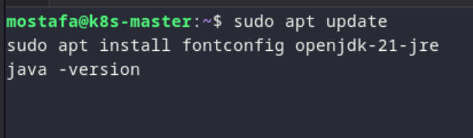

*Cloning the source code and Dockerfile from GitHub.*

### 2. Create the pipeline

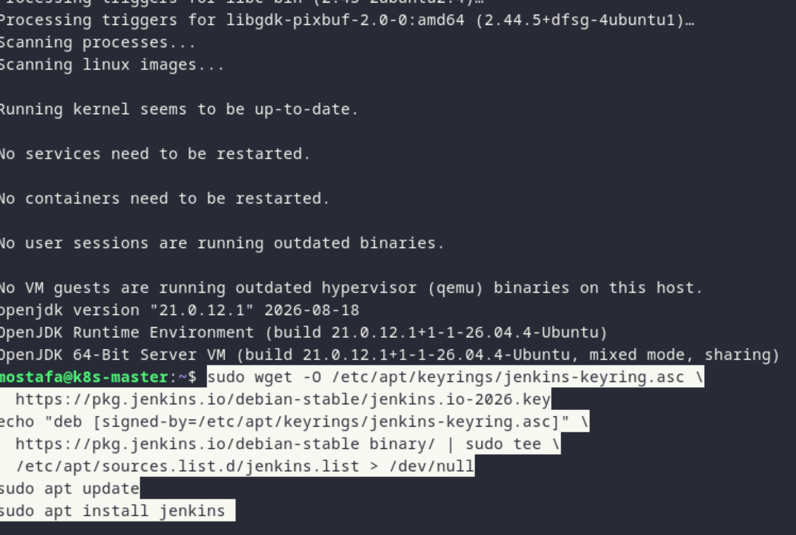

*Creating the Jenkins pipeline.*

### 3. Build app

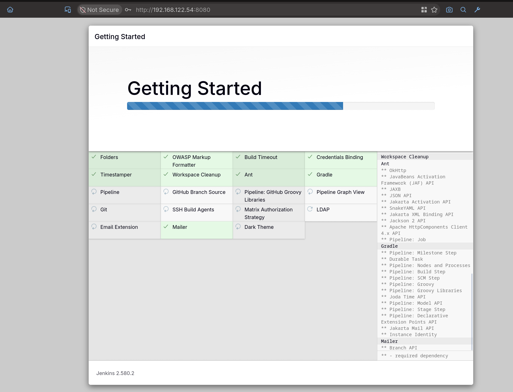

*Building the app.*

### 4. Build Docker image

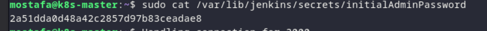

*Building the Docker image.*

### 5. Scan Docker image

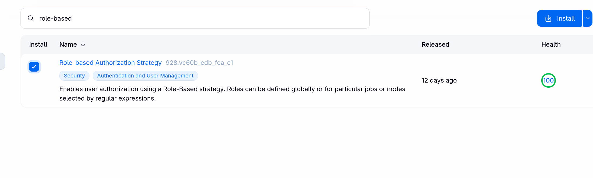

*Scanning the Docker image.*

### 6. Push image to DockerHub

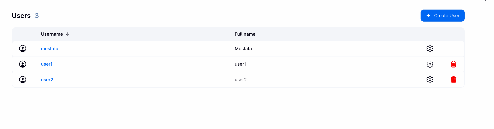

*Pushing the image to DockerHub.*

### 7. Delete image locally

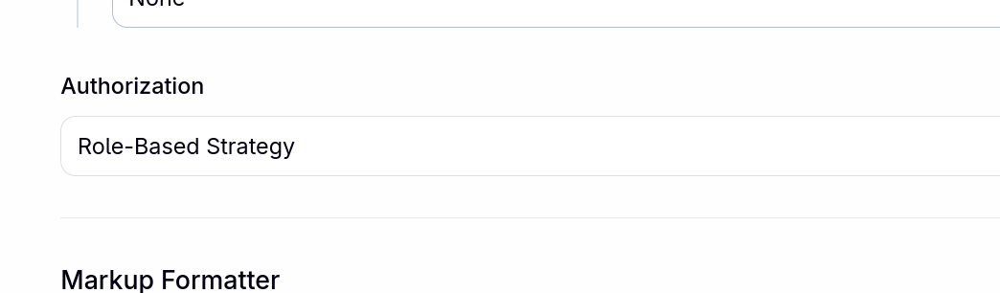

*Deleting the image locally.*

### 8. Update image in deployment file

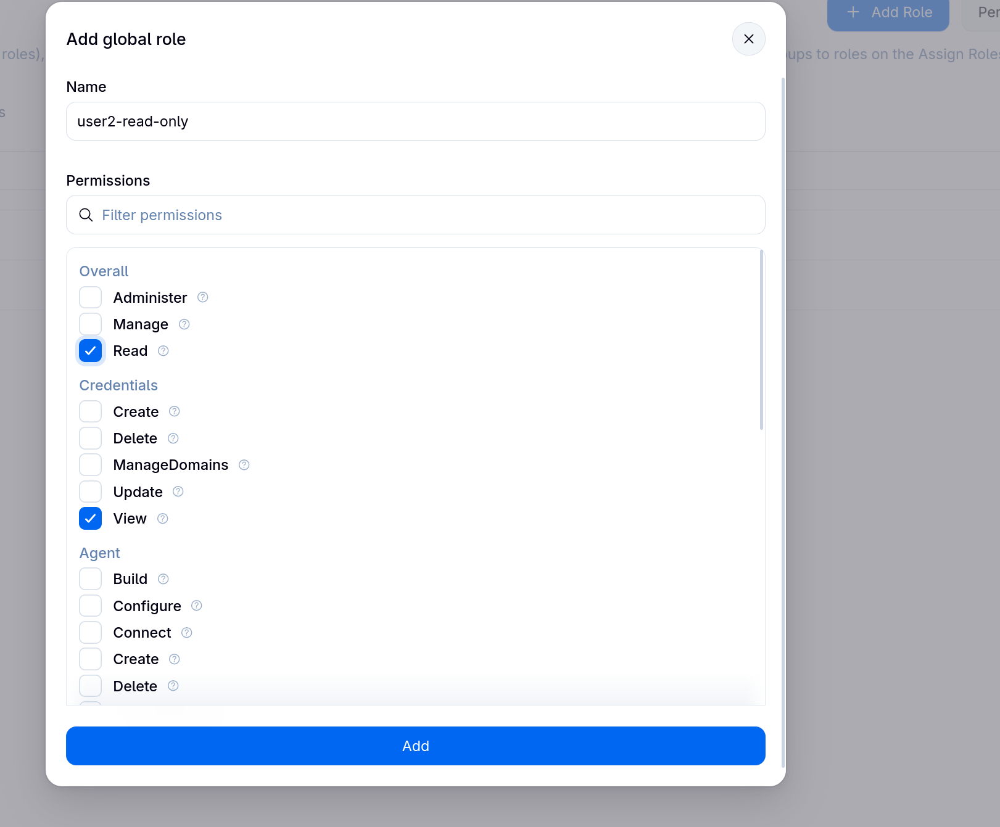

*Updating the image in the deployment file.*

### 9. Deploy to Kubernetes cluster

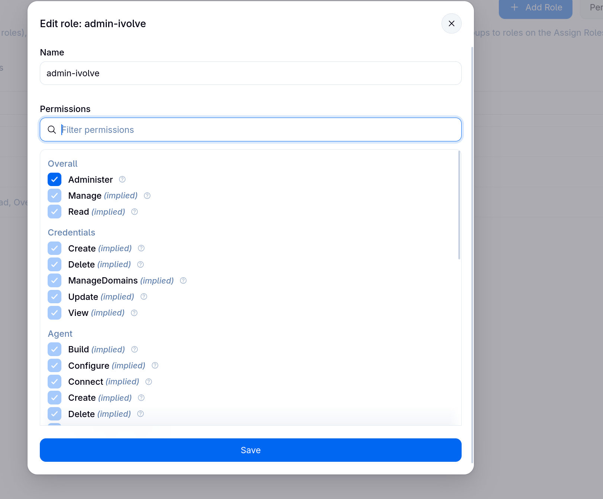

*Deploying to the Kubernetes cluster.*

### 10. Set post actions

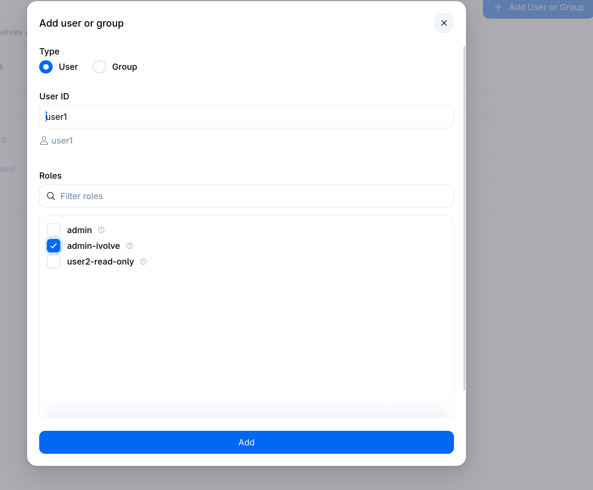

*Setting the pipeline post actions (always, success, failure).*

### 11. Verify pipeline result

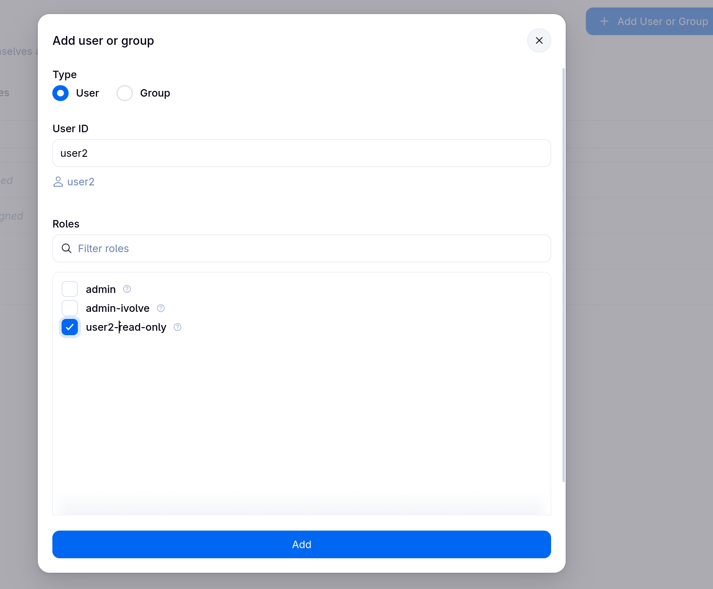

*Verifying the pipeline result.*

### 12. Check DockerHub push

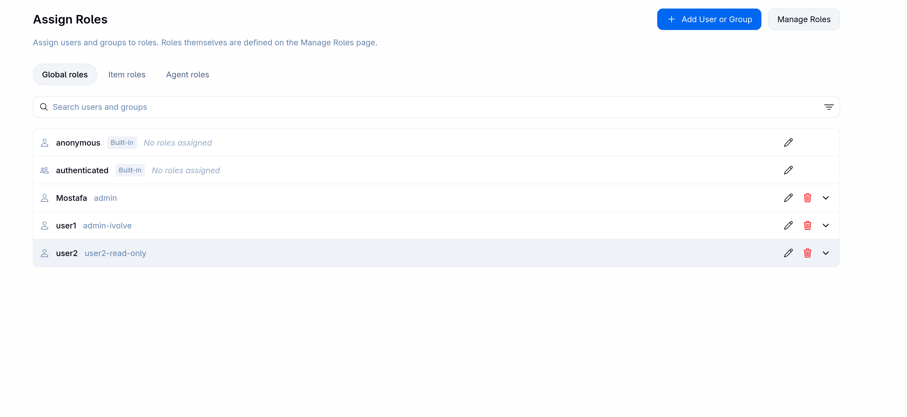

*Checking the DockerHub push.*

### 13. Check deployment update

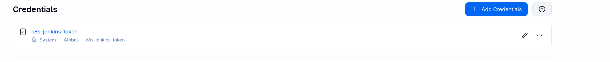

*Checking the deployment update.*

### 14. Check final deployment

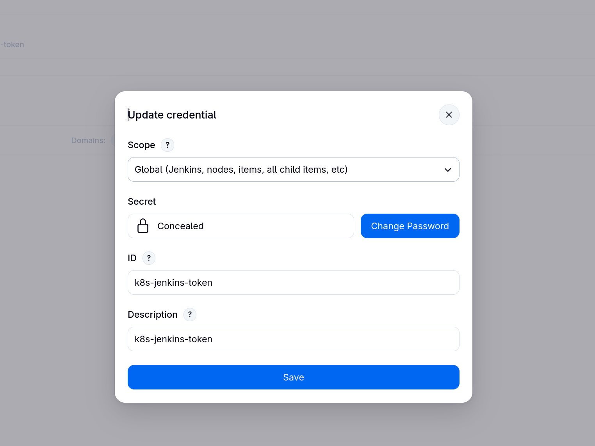

*Confirming the final deployment.*
