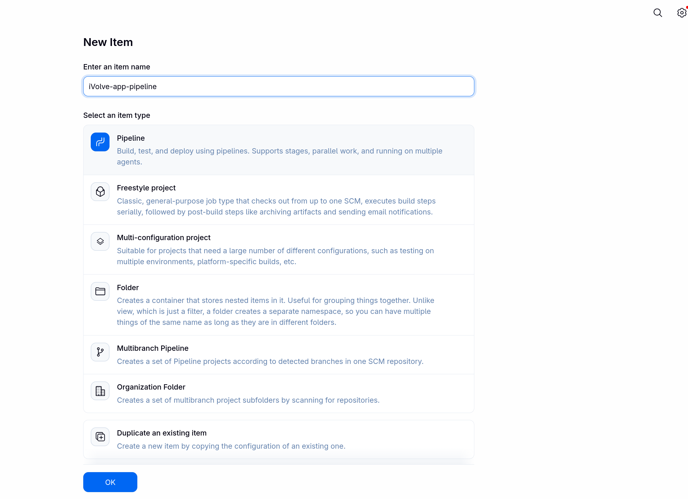
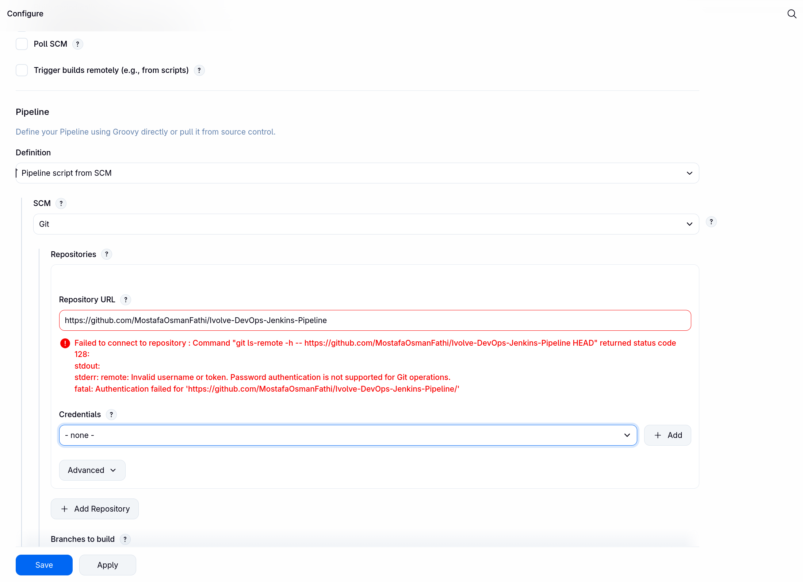
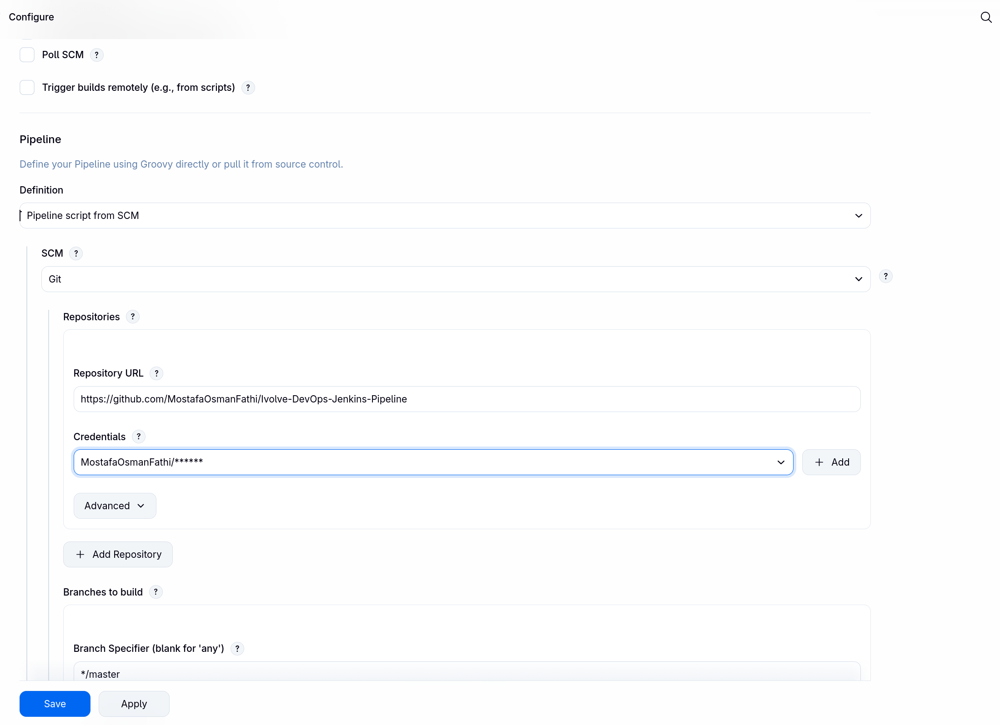
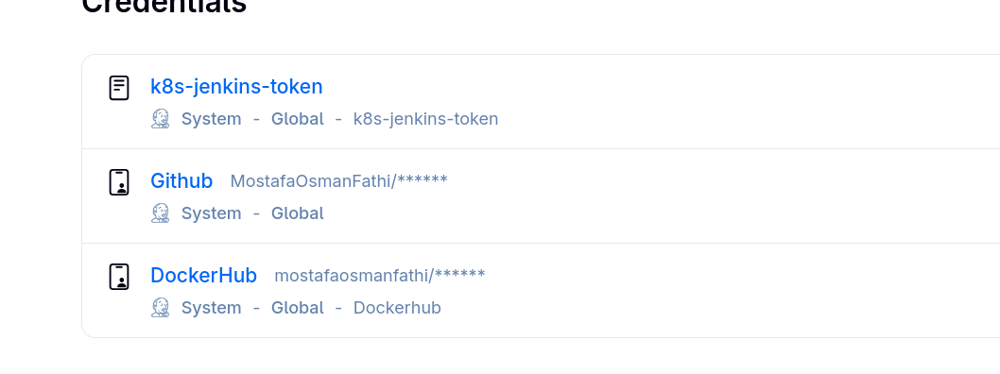
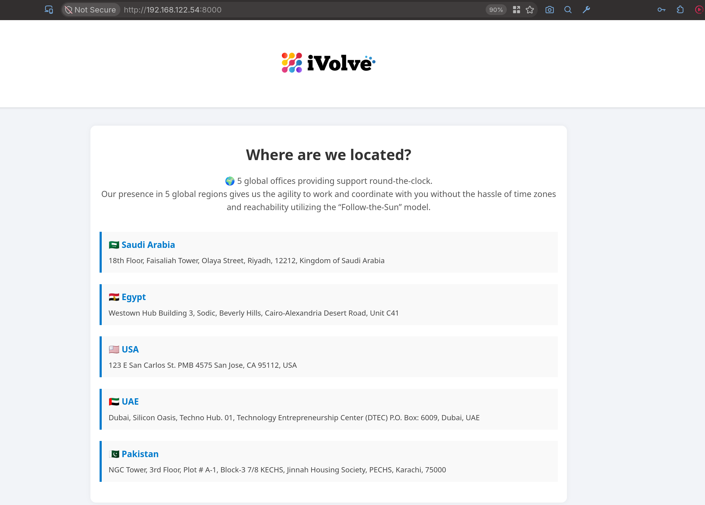
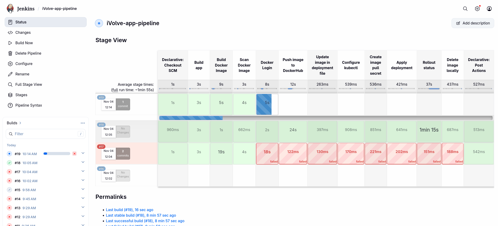
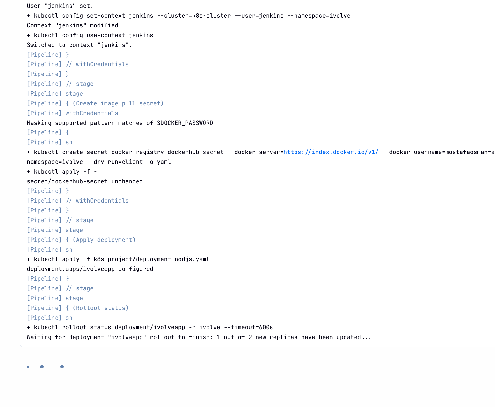
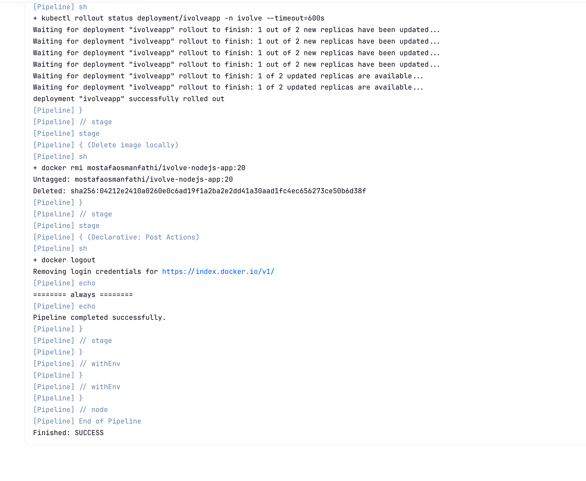
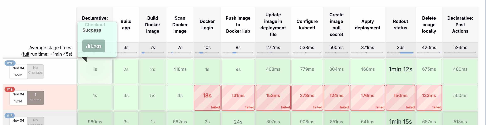
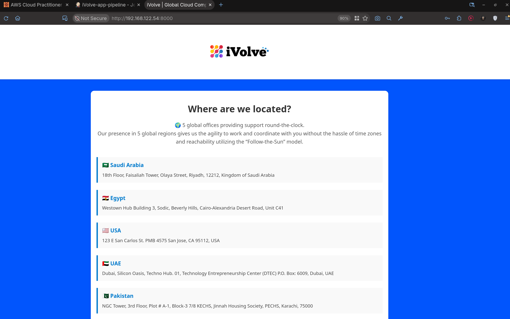

# Lab 21 - Jenkins Pipeline for Frontend Color Change

## Overview

Run the Jenkins pipeline to build, scan, push, update, and deploy the app, then confirm the frontend color change and successful pipeline run.

## Proof

### 1. Before pipeline

*Checking the Jenkins job before running the pipeline.*

*Reviewing the Jenkins job before the pipeline runs.*

*Reviewing the pipeline settings before execution.*

*Reviewing the pipeline script before execution.*

*Confirming the job state before the pipeline starts.*

### 2. Start pipeline

*Starting the Jenkins pipeline.*

### 3. Run pipeline

*Running the Jenkins pipeline stage.*

*Running the next pipeline stage.*

*Running the final pipeline stage.*

### 4. Frontend color changed and pipeline succeeded

*Confirming the frontend color change and successful pipeline run.*
