# Lab 22 - Jenkins Shared Library Pipeline

## Overview

Use a Jenkins shared library to define reusable pipeline steps for building the app, building/pushing the Docker image, and deploying to Kubernetes, then verify the agent setup and pipeline run.

## Proof

### 1. Before pipeline

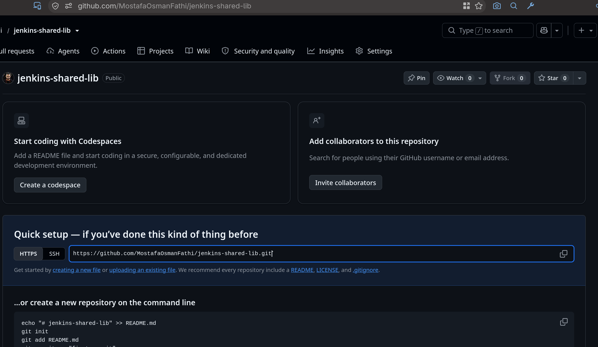

*Checking the Jenkins job before running the pipeline.*

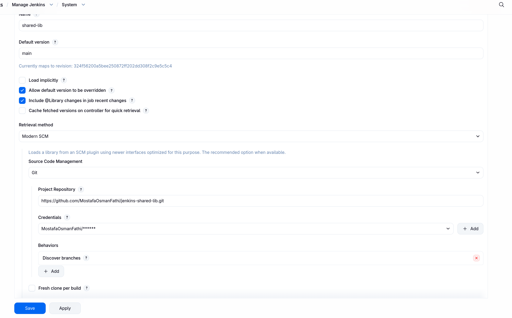

*Reviewing the Jenkins job before the pipeline runs.*

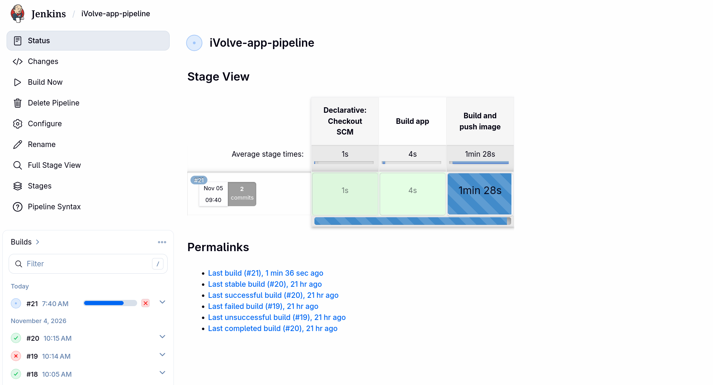

*Reviewing the pipeline configuration before execution.*

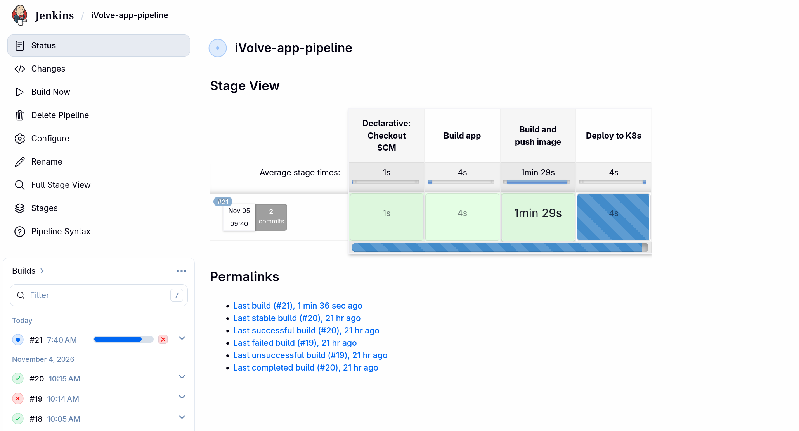

*Reviewing the shared library setup before execution.*

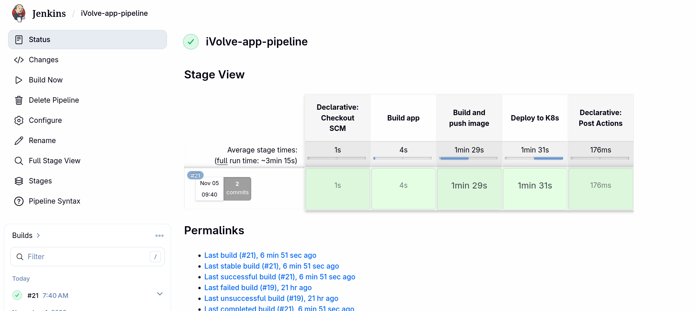

*Reviewing the shared library variables before execution.*

### 2. Agent install on controller

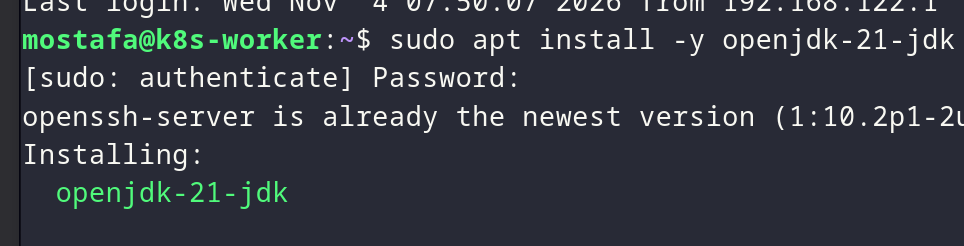

*Installing the Jenkins agent on the controller.*

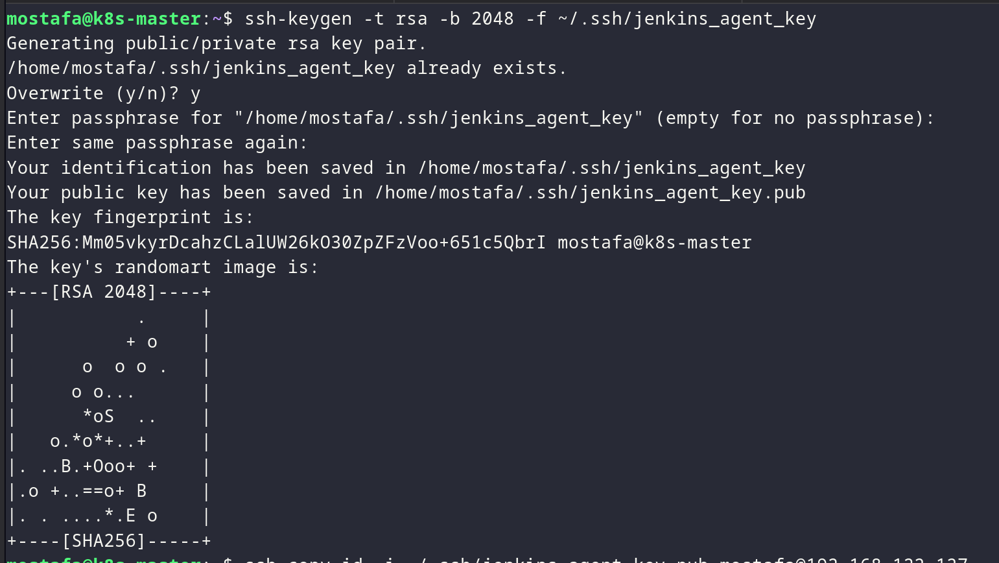

*Verifying the controller agent installation.*

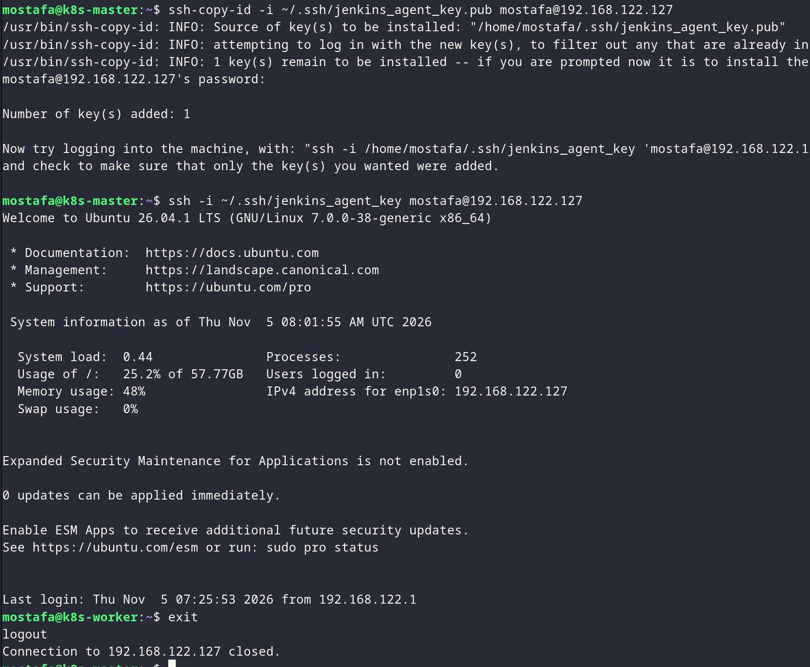

*Checking the controller agent status.*

### 3. Agent install on slave

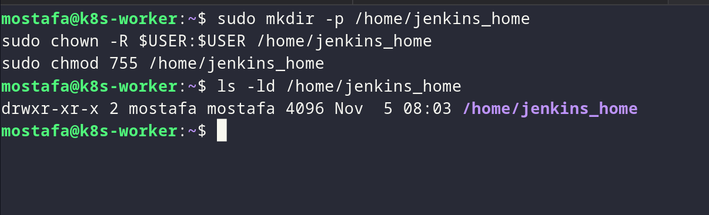

*Installing the Jenkins agent on the slave.*

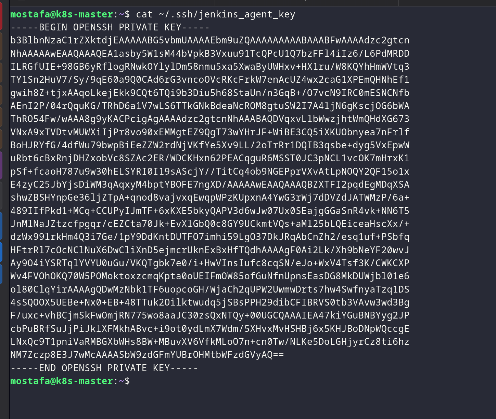

*Verifying the slave agent installation.*

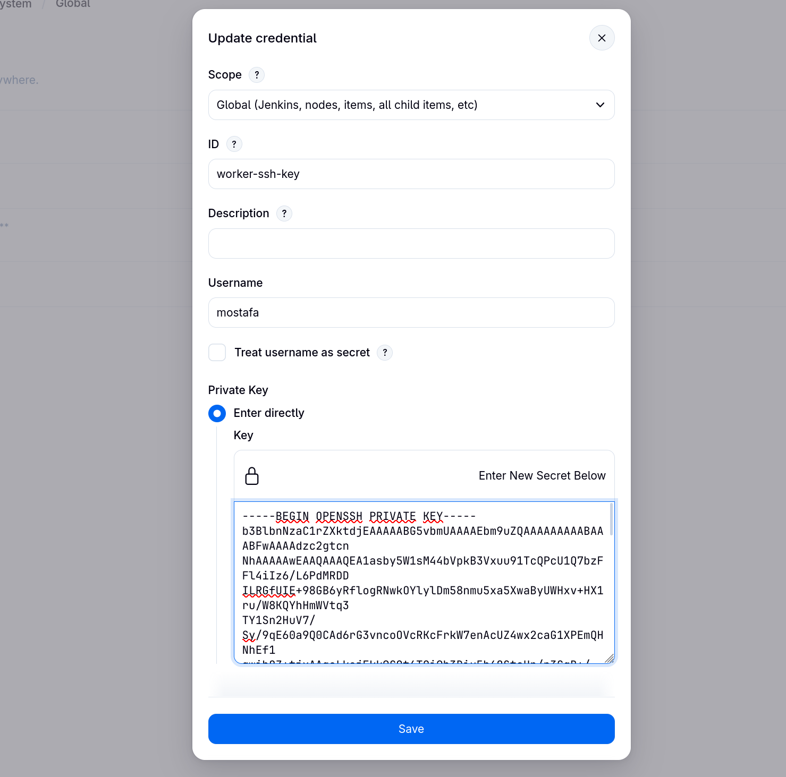

*Checking the slave agent status.*

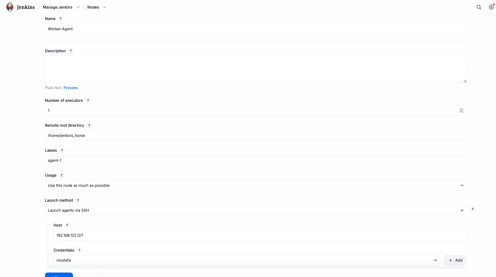

*Testing the slave agent connection.*

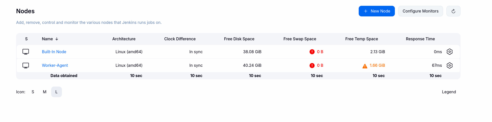

*Running the pipeline on the slave agent.*

### 4. Testing agent

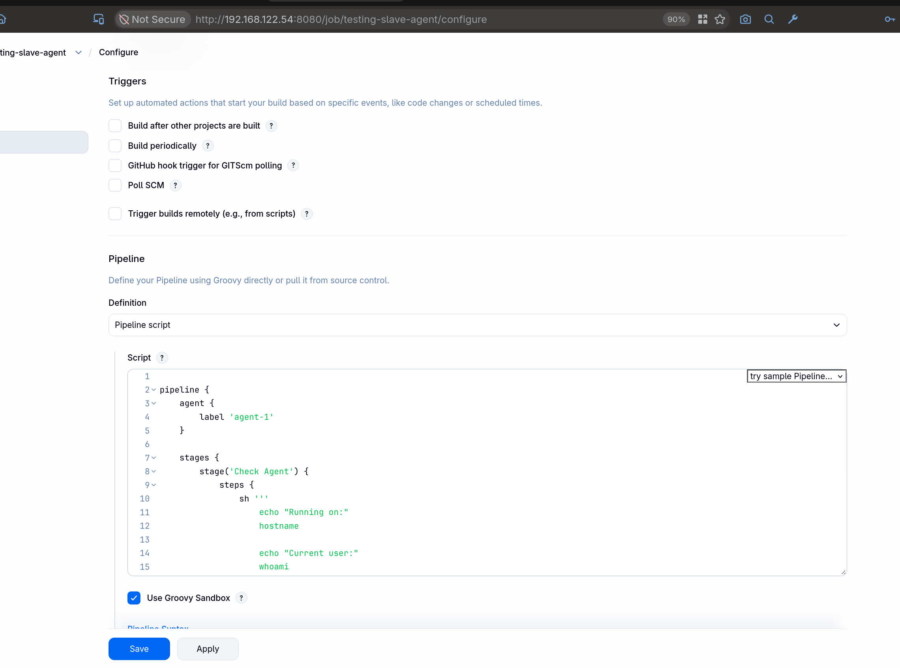

*Testing the agent for pipeline execution.*

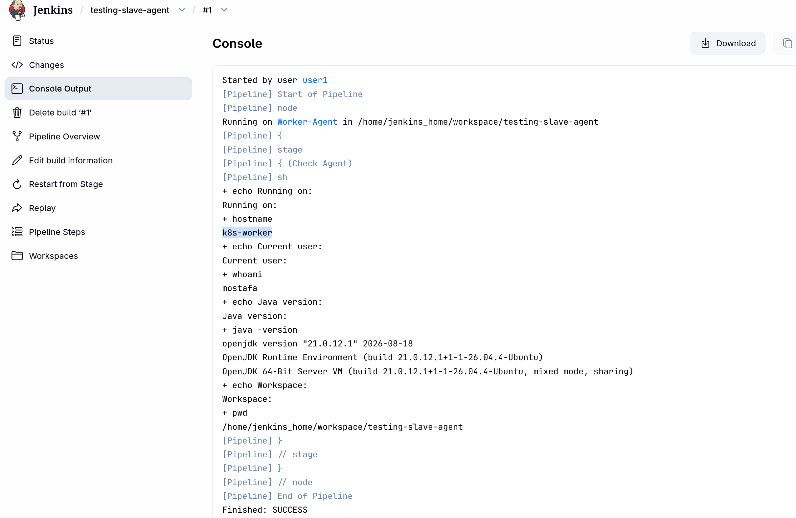

*Confirming the pipeline result.*
