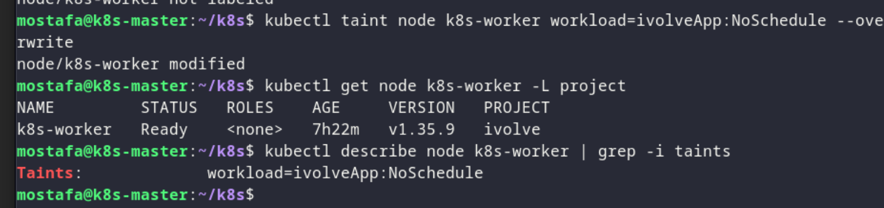
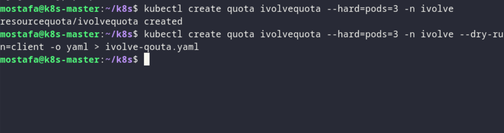

# Lab 10 - Kubernetes Config & Storage

## Overview

Working with ConfigMaps, Secrets, and volumes in Kubernetes.

## Proof

### 1. Apply resources

*Creating ConfigMaps, Secrets, and related resources.*

### 2. Check pods

*Verifying pods are running after applying the manifests.*

### 3. Verify data

*Checking injected config/secrets or mounted volumes inside the pod.*
