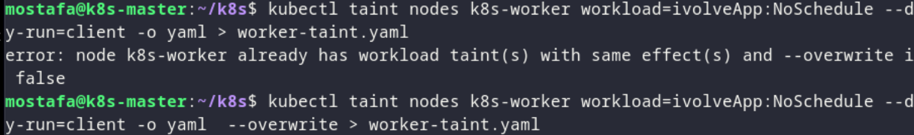

# Lab 11 - Kubernetes Deployments & Scaling

## Overview

Using Deployments to manage pods, with scaling and updates.

## Proof

### 1. Create deployment

*Creating a Deployment to run and manage pods.*

### 2. Check deployment and pods

*Verifying the Deployment and its pods are running.*

### 3. Scale the app

*Scaling up/down to change the number of replicas.*

### 4. Update the app

*Applying a rolling update and checking the new version.*
