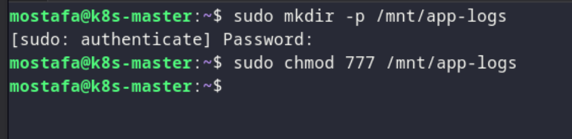
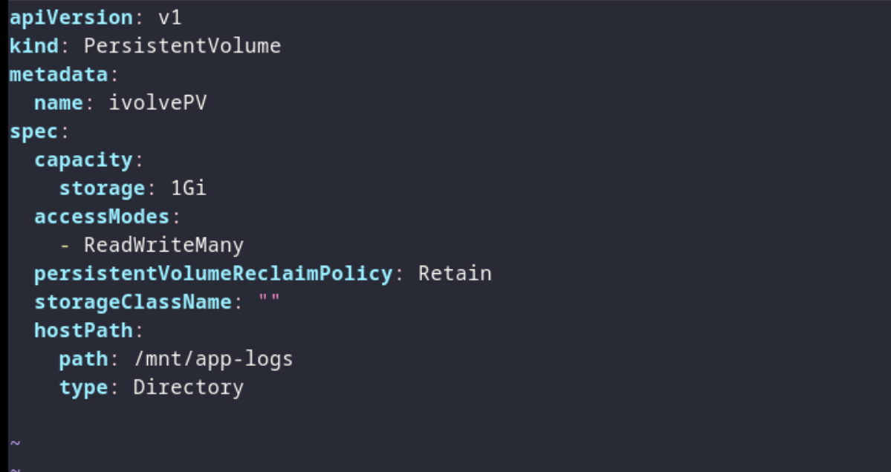
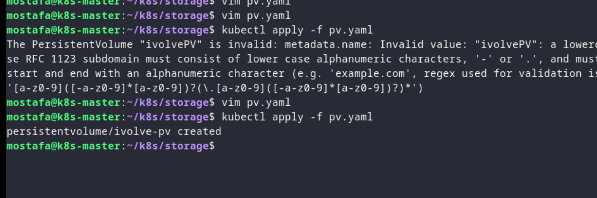
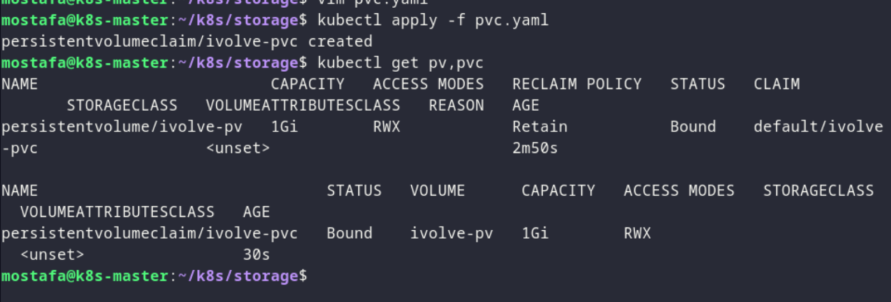

# Lab 13 - Kubernetes Persistent Storage

## Overview

Setting up persistent storage for application logs using a PersistentVolume and PersistentVolumeClaim.

## Proof

### 1. Create the Persistent Volume

*Defining a PersistentVolume with hostPath storage for application logs.*

### 2. Create the Persistent Volume Claim

*Requesting a PersistentVolumeClaim for the application logs.*

### 3. Apply the storage resources

*Creating the PersistentVolume and PersistentVolumeClaim.*

### 4. Verify the storage

*Checking that the storage resources are bound and ready.*
