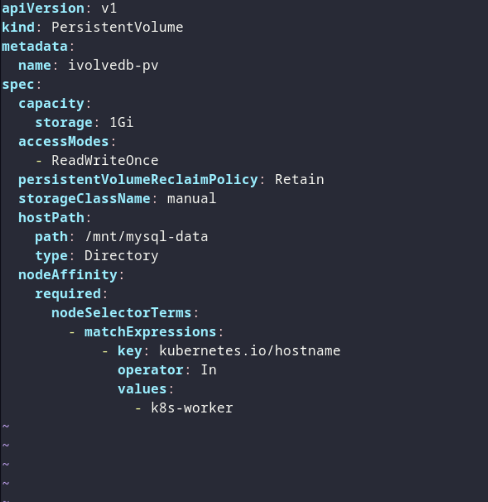
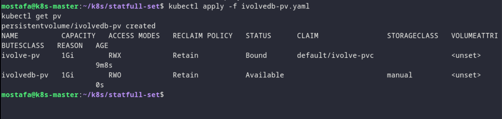
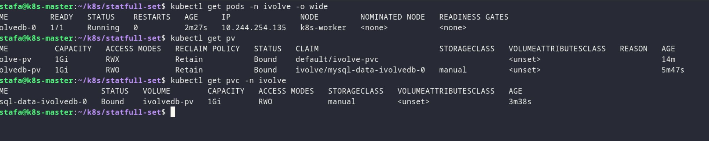
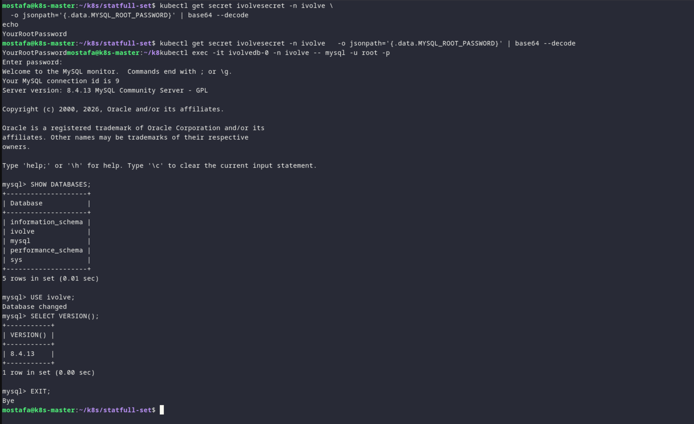

# Lab 14 - Kubernetes StatefulSet & Headless Service

## Overview

Deploying the MySQL database as a StatefulSet with a headless service and persistent storage.

## Proof

### 1. Create the MySQL StatefulSet


*Creating the StatefulSet and its headless service for the database.*

`mysql-statfulset.yaml`

```yaml
apiVersion: v1
kind: Service
metadata:
  name: ivolvedbsvc
  namespace: ivolve
spec:
  clusterIP: None
  selector:
    app: ivolvedb
  ports:
    - name: mysql
      port: 3306
      targetPort: 3306
---
apiVersion: apps/v1
kind: StatefulSet
metadata:
  name: ivolvedb
  namespace: ivolve
spec:
  serviceName: ivolvedbsvc
  replicas: 1
  selector:
    matchLabels:
      app: ivolvedb
  template:
    metadata:
      labels:
        app: ivolvedb
    spec:
      nodeSelector:
        project: ivolve
      tolerations:
        - key: workload
          operator: Equal
          value: ivolveApp
          effect: NoSchedule
      containers:
        - name: mysql
          image: mysql:8.4
          ports:
            - name: mysql
              containerPort: 3306
          envFrom:
            - configMapRef:
                name: ivolvecm
            - secretRef:
                name: ivolvesecret
          env:
            - name: MYSQL_DATABASE
              value: ivolve
            - name: MYSQL_USER
              valueFrom:
                configMapKeyRef:
                  name: ivolvecm
                  key: DB_USER
            - name: MYSQL_PASSWORD
              valueFrom:
                secretKeyRef:
                  name: ivolvesecret
                  key: DB_PASSWORD
          volumeMounts:
            - name: mysql-data
              mountPath: /var/lib/mysql
  volumeClaimTemplates:
    - metadata:
        name: mysql-data
      spec:
        accessModes:
          - ReadWriteOnce
        storageClassName: manual
        resources:
          requests:
            storage: 1Gi
```

### 2. Check the database pod


*Verifying the StatefulSet and the MySQL pod are running.*

### 3. Confirm the database is ready


*Connecting with a MySQL client to verify the database is operational.*

### 4. Verify the database data


*Confirming the database data is stored in the persistent volume.*

### 5. Verify the headless service


*Verifying the headless service DNS resolves to the database pod.*
