# Lab 15 - Node.js Application Deployment with ClusterIP Service

## Overview

Deploy the Node.js app on Kubernetes with 2 replicas, using the Docker Hub image from Lab 8, env vars from ConfigMap/Secret, node selector/toleration, PVC, init container, and ClusterIP service.

## Proof

### 1. Prepare the node

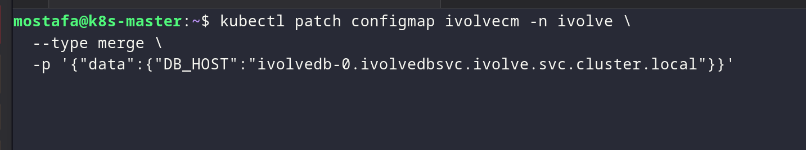

*Checking the node labels and taints before scheduling the app.*

### 2. Create the Node.js Deployment

`deployment-nodjs.yaml`

```yaml
apiVersion: apps/v1
kind: Deployment
metadata:
  name: ivolveapp
  namespace: ivolve
spec:
  replicas: 2
  selector:
    matchLabels:
      app: ivolveapp
  template:
    metadata:
      labels:
        app: ivolveapp
    spec:
      nodeSelector:
        project: ivolve
      tolerations:
        - key: workload
          operator: Equal
          value: ivolveApp
          effect: NoSchedule

      initContainers:
        - name: setup-database
          image: mysql:8.4
          command: ["/bin/sh", "-c"]
          args:
            - |
              until mysqladmin ping -h "$DB_HOST" -uroot -p"$MYSQL_ROOT_PASSWORD" --silent; do
                echo "Waiting for MySQL..."
                sleep 5
              done

              mysql -h "$DB_HOST" -uroot -p"$MYSQL_ROOT_PASSWORD" <<SQL
              CREATE DATABASE IF NOT EXISTS ivolve;
              CREATE USER IF NOT EXISTS '${DB_USER}'@'%' IDENTIFIED BY '${DB_PASSWORD}';
              GRANT ALL PRIVILEGES ON ivolve.* TO '${DB_USER}'@'%';
              FLUSH PRIVILEGES;
              SQL
              echo "Database and privileges configured successfully."
          env:
            - name: DB_HOST
              valueFrom:
                configMapKeyRef:
                  name: ivolvecm
                  key: DB_HOST
            - name: DB_USER
              valueFrom:
                configMapKeyRef:
                  name: ivolvecm
                  key: DB_USER
            - name: MYSQL_ROOT_PASSWORD
              valueFrom:
                secretKeyRef:
                  name: ivolvesecret
                  key: MYSQL_ROOT_PASSWORD
            - name: DB_PASSWORD
              valueFrom:
                secretKeyRef:
                  name: ivolvesecret
                  key: DB_PASSWORD

      containers:
        - name: node-app
          image: mostafaosmanfathi/ivolve-nodejs-app:latest
          imagePullPolicy: Always
          ports:
            - containerPort: 3000
          env:
            - name: DB_HOST
              valueFrom:
                configMapKeyRef:
                  name: ivolvecm
                  key: DB_HOST
            - name: DB_USER
              valueFrom:
                configMapKeyRef:
                  name: ivolvecm
                  key: DB_USER
            - name: DB_PASSWORD
              valueFrom:
                secretKeyRef:
                  name: ivolvesecret
                  key: DB_PASSWORD
            - name: DB_NAME
              value: ivolve
          volumeMounts:
            - name: app-logs
              mountPath: /app/logs

      volumes:
        - name: app-logs
          persistentVolumeClaim:
            claimName: ivolve-app-pvc

```

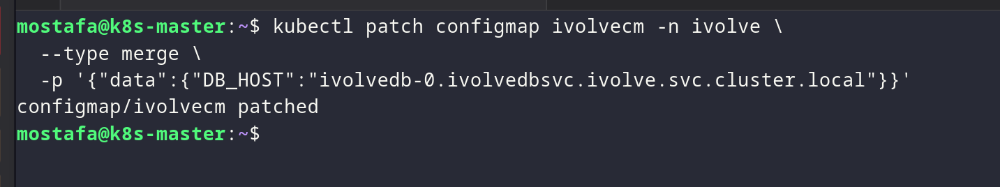

*Creating the Node.js Deployment with 2 replicas, storage, and database setup.*

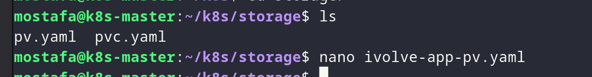

*Creating the init container that prepares the database.*

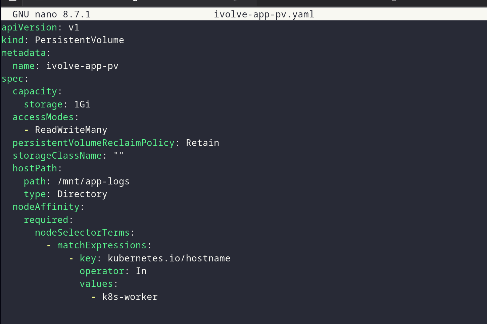

*Configuring the app environment variables and storage.*

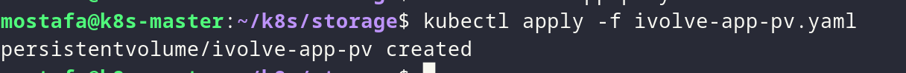

*Applying the Node.js Deployment to the cluster.*

### 3. Check the Deployment and pods

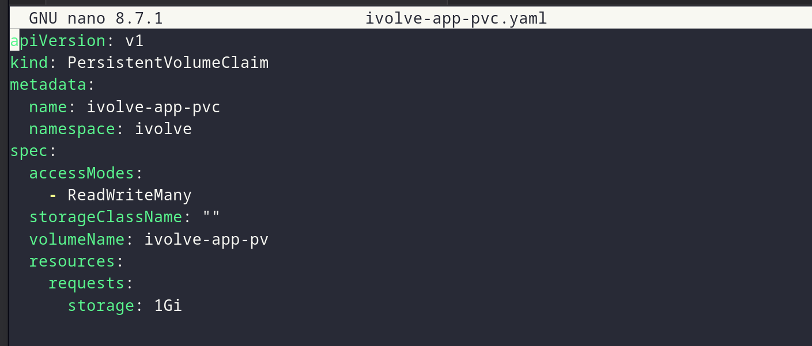

*Verifying the Deployment and pods are running.*

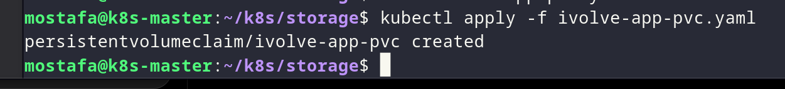

*Checking that both Node.js pods are healthy.*

### 4. Create the ClusterIP service

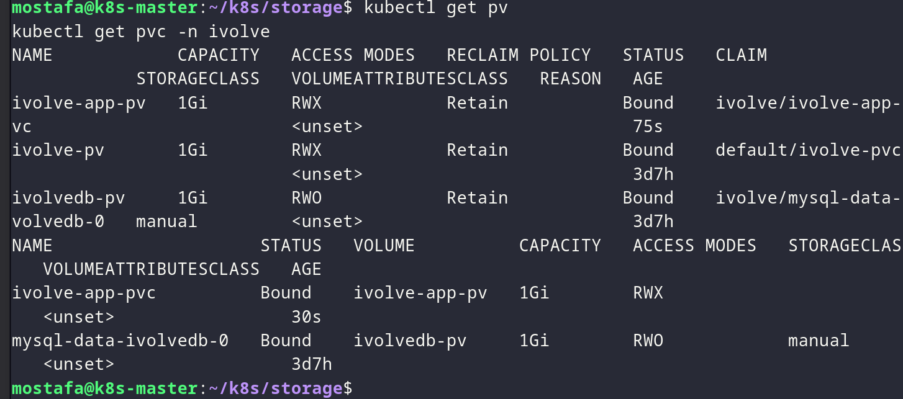

*Creating the ClusterIP service to expose the app.*

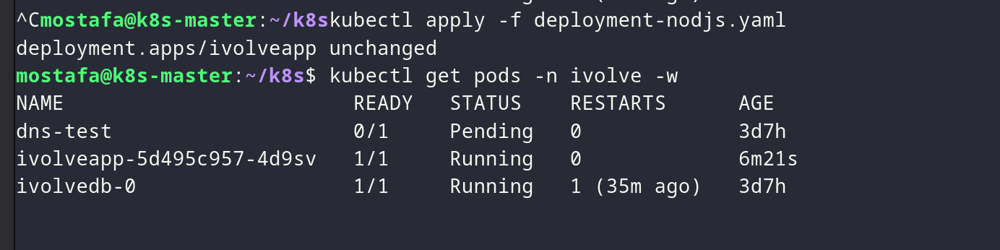

*Verifying the ClusterIP service endpoint.*

### 5. Verify the database and logs

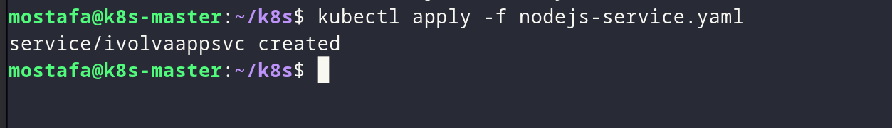

*Verifying the database and user privileges.*

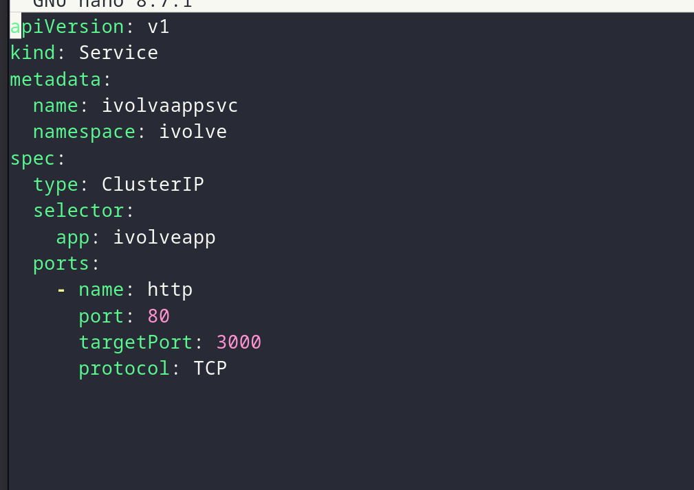

*Checking the Node.js app logs for a successful database connection.*

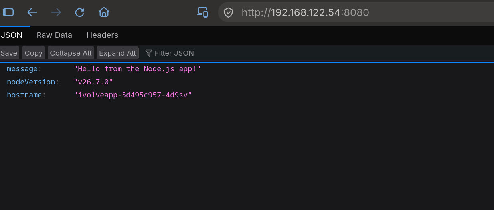

*Verifying the persistent volume claim is bound.*

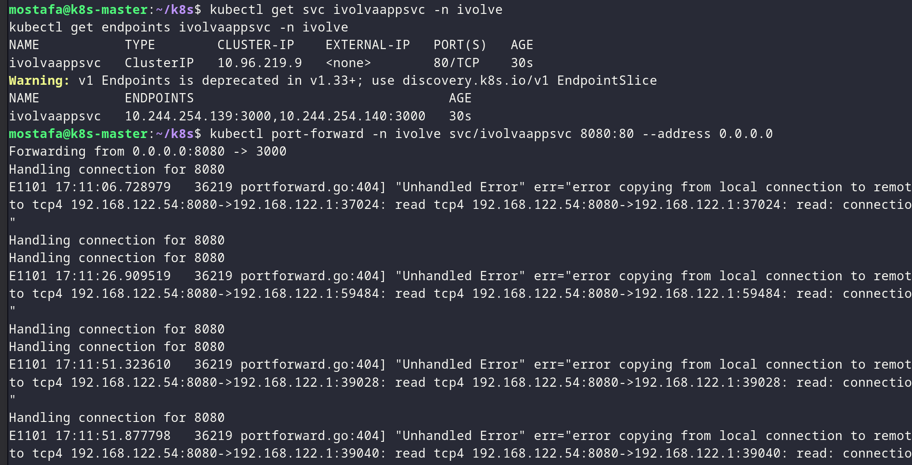

*Verifying the service endpoint is ready.*

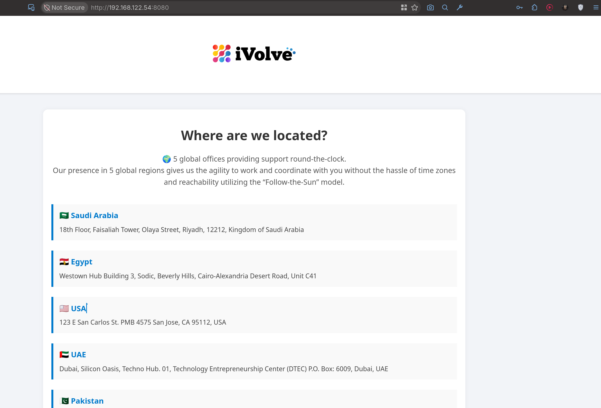

*Connecting to MySQL to verify the database and user.*

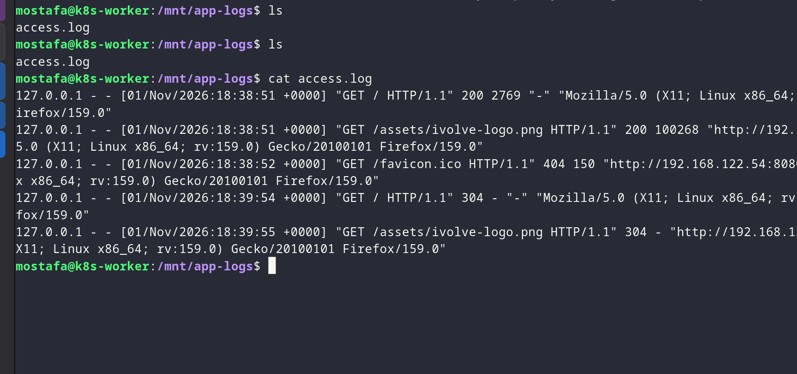

*Confirming the full deployment is working.*
