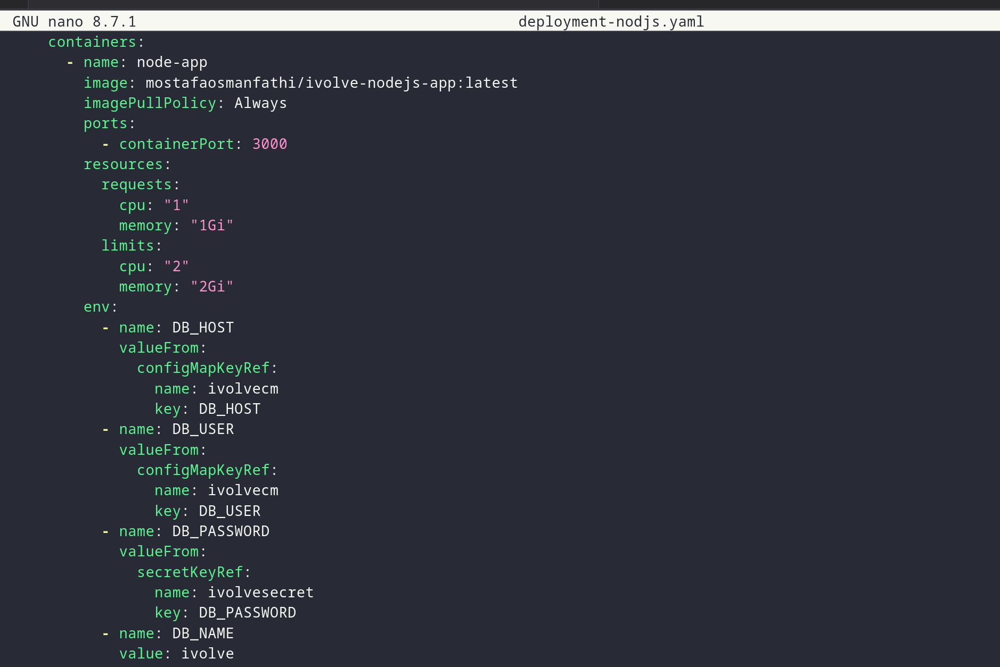
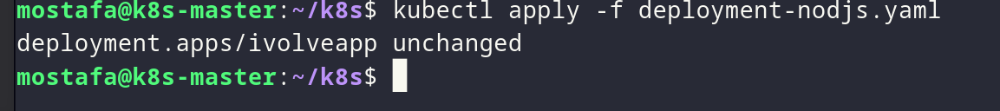
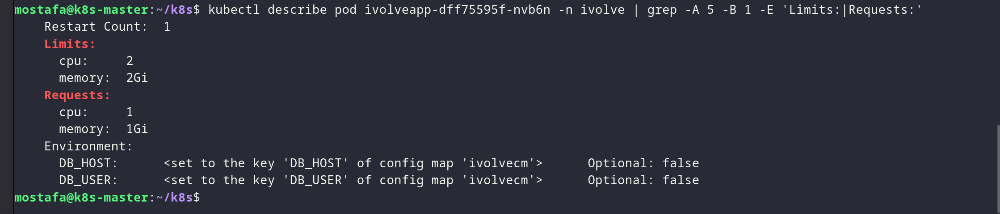

# Lab 16 - Pod Resource Management with CPU and Memory Requests and Limits

## Overview

Update the existing `ivolveApp` Deployment with CPU and memory requests and limits, then verify them with `kubectl describe pod` and monitor real-time usage with `kubectl top pod` (the metric server must be running).

## Proof

### 1. Update the Deployment resources

Update the `ivolveApp` Deployment with resource requests and limits.

*Adding CPU and memory requests and limits to the ivolveApp Deployment.*

### 2. Verify the resources

*Checking the pod resource requests and limits with `kubectl describe pod`.*

### 3. Monitor real-time usage

*Monitoring real-time CPU and memory usage with `kubectl top pod`.*
