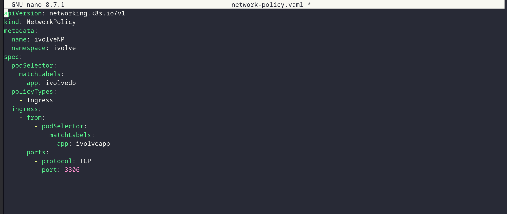
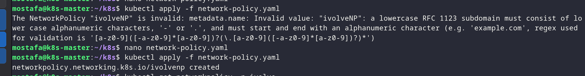
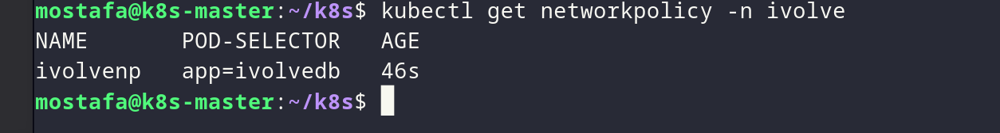
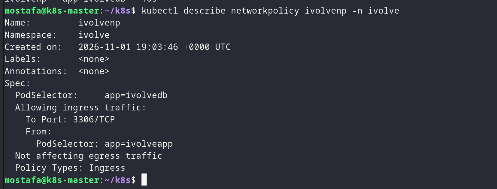

# Lab 17 - Control Pod-to-Pod Traffic via Network Policy

## Overview

Control pod-to-pod traffic with a Kubernetes Network Policy that allows the MySQL pod to receive traffic only from the application pods on port 3306.

## Proof

### 1. Create the Network Policy

Create the `ivolveNP` Network Policy to allow MySQL traffic from the application pods only.

*Creating the Network Policy to allow MySQL traffic from the app pods only.*

### 2. Verify the Network Policy

*Checking that the Network Policy is applied to the mysql pod.*

### 3. Check the enforced traffic

*Verifying that only the app pods can reach MySQL on port 3306.*

### 4. Confirm the policy status

*Confirming the Network Policy is active and enforced.*
