# Lab 18 - Node-Wide Pod Management with DaemonSet

## Overview

Deploy a monitoring stack in a dedicated namespace using a DaemonSet for the Prometheus node-exporter, then validate scheduling and metrics exposure, and configure Prometheus and Grafana.

## Proof

### 1. Create the monitoring namespace

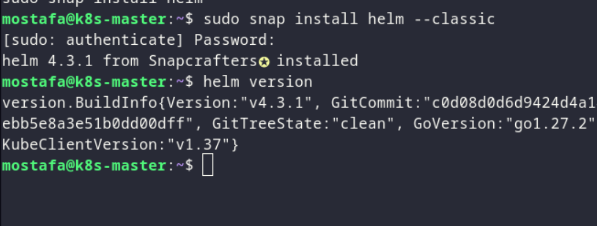

*Creating the monitoring namespace.*

### 2. Deploy Prometheus

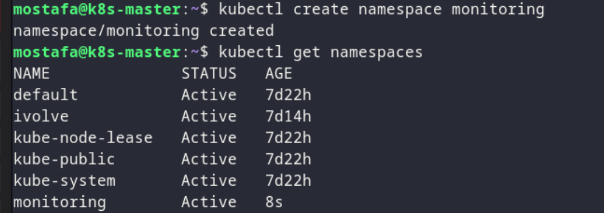

*Deploying Prometheus in the monitoring namespace.*

### 3. Deploy Alert Manager

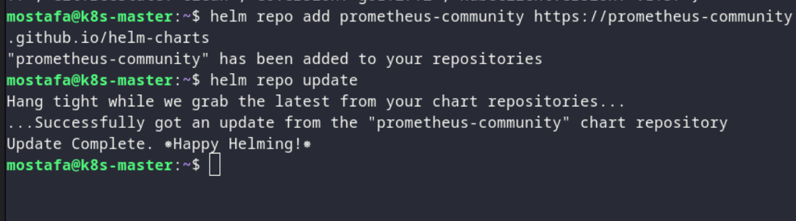

*Deploying Alert Manager in the monitoring namespace.*

### 4. Deploy Grafana

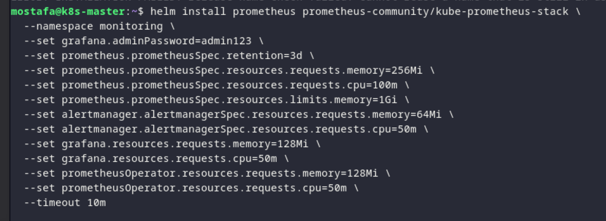

*Deploying Grafana in the monitoring namespace.*

### 5. Deploy the node-exporter DaemonSet

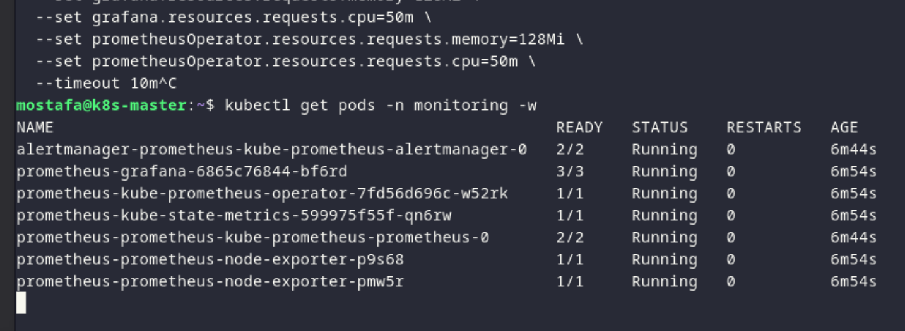

*Deploying the Prometheus node-exporter DaemonSet.*

### 6. Validate the node-exporter pod

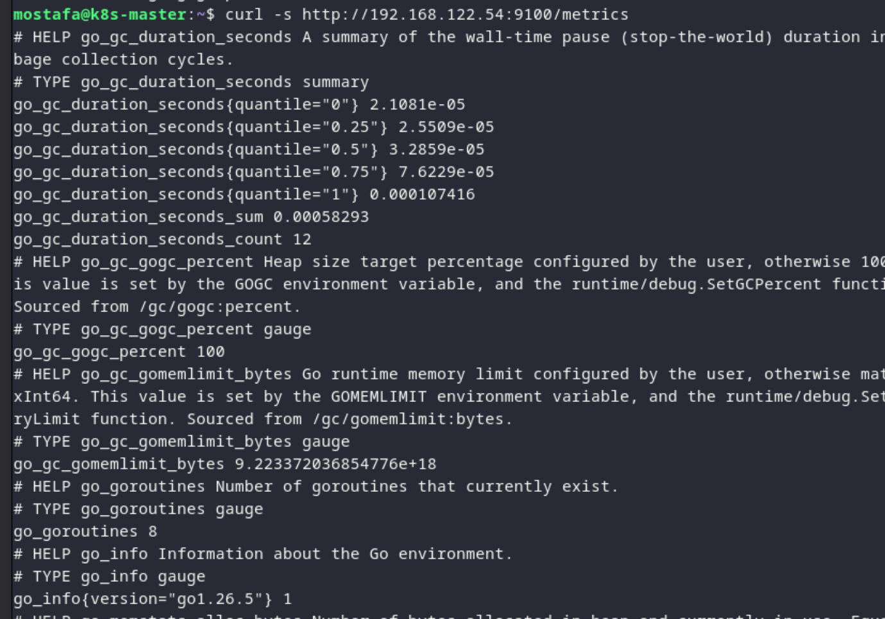

*Validating that a node-exporter pod is scheduled on each node.*

### 7. Confirm metrics exposure

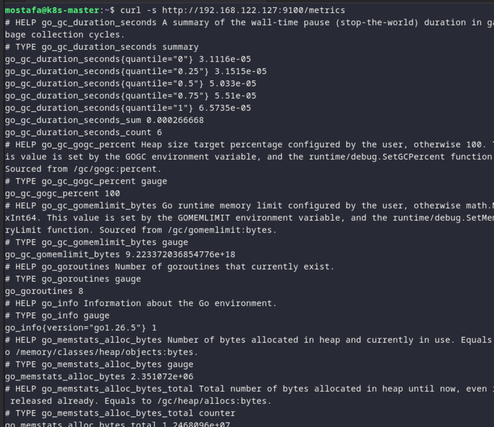

*Confirming metrics exposure on `<node_IP>:9100/metrics`.*

### 8. Configure Prometheus

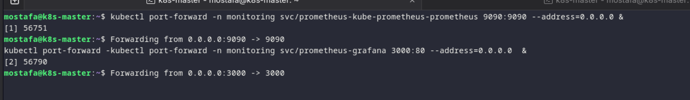

*Configuring Prometheus to collect node-exporter metrics.*

### 9. Configure Grafana dashboard

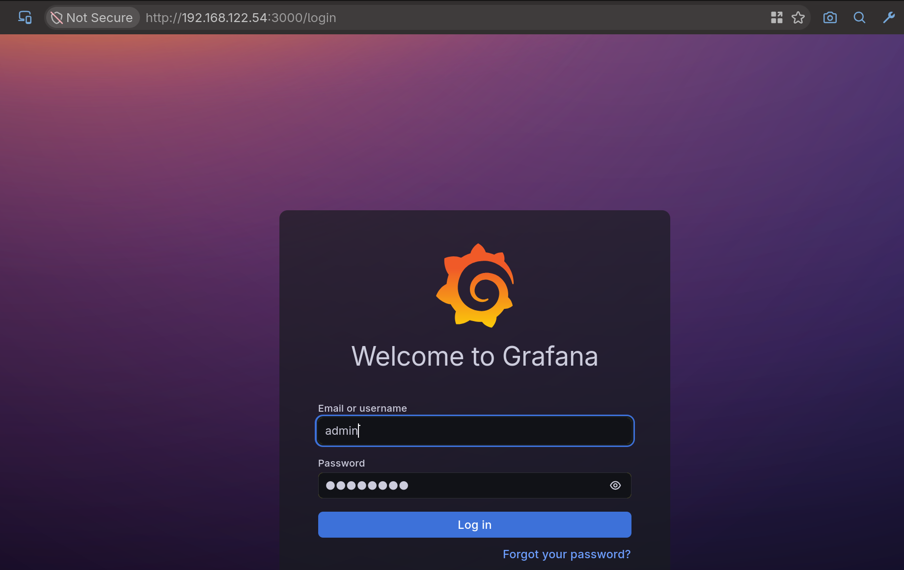

*Configuring the Grafana dashboard.*

### 10. Verify the monitoring stack

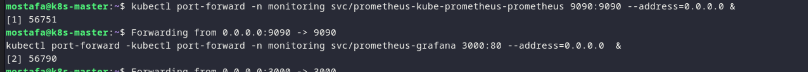

*Verifying Prometheus and Grafana are running.*

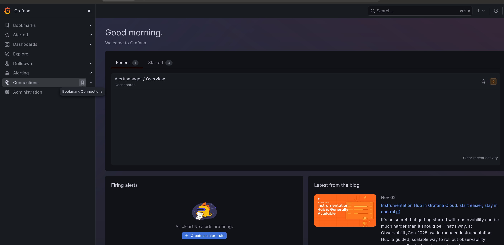

*Verifying the monitoring stack is running.*

### 11. Check the final monitoring resources

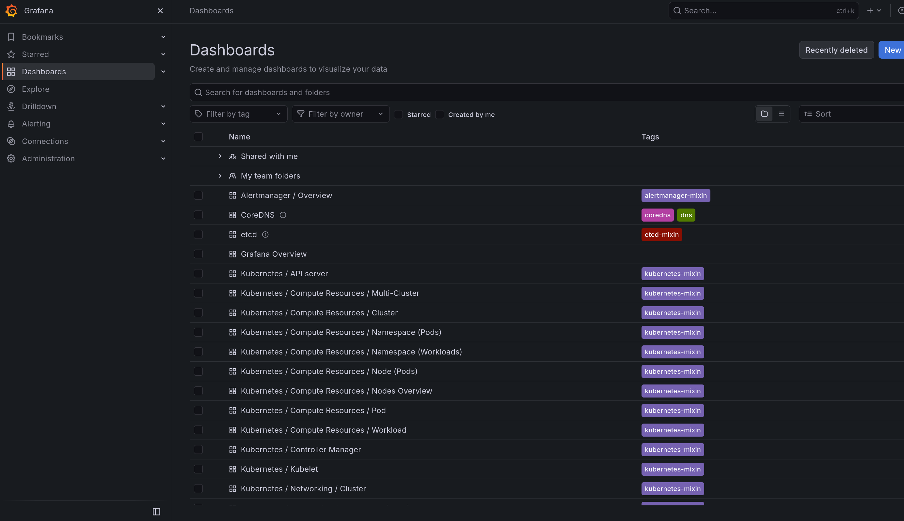

*Confirming the monitoring resources.*

### 12. Check the DaemonSet status

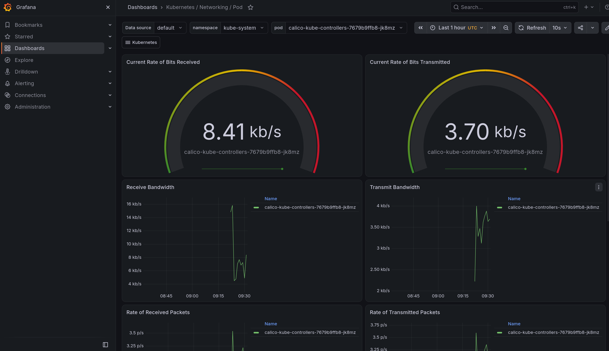

*Confirming the DaemonSet status.*
