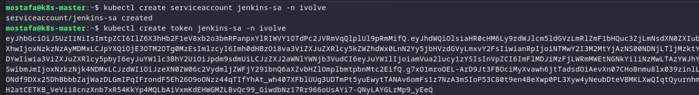
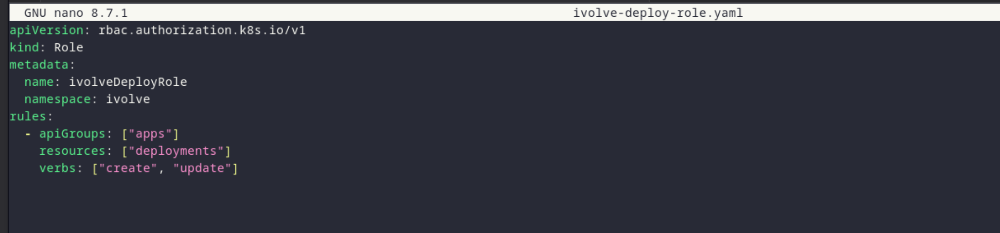
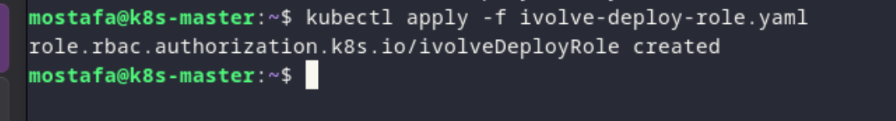
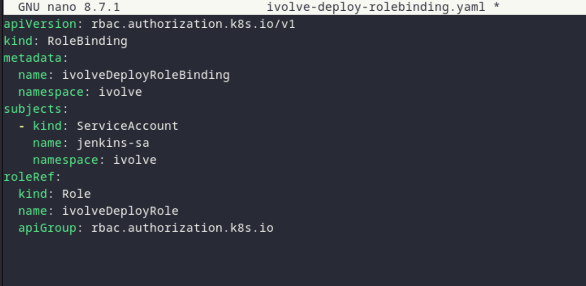
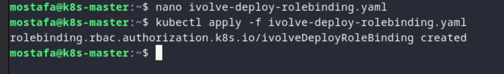

# Lab 19 - Securing Kubernetes with RBAC and Service Accounts

## Overview

Secure the Kubernetes cluster by creating a Jenkins service account, token, deploy role, and role binding, then validate the role permissions.

## Proof

### 1. Create the Jenkins Service Account

*Creating the jenkinsSA service account in the ivolve namespace.*

### 2. Create the service account token

*Creating a token for the service account.*

### 3. Define the deploy role

*Defining the ivolveDeployRole with create/update permissions on deployments in the ivolve namespace.*

### 4. Create the role binding

*Creating the ivolveDeployRoleBinding to bind the role to the jenkinsSA service account.*

### 5. Validate the permissions

*Validating that the role can only create/update deployments in the ivolve namespace.*
