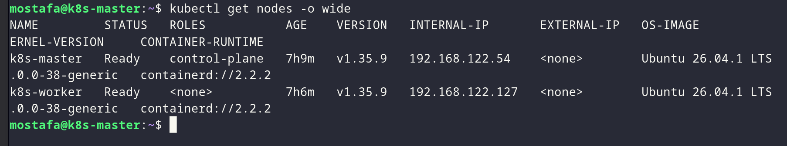
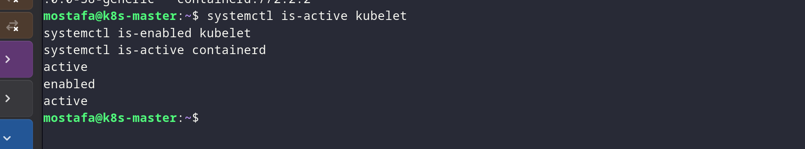
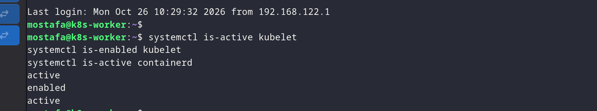
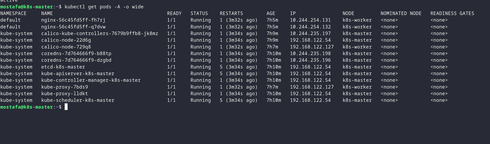
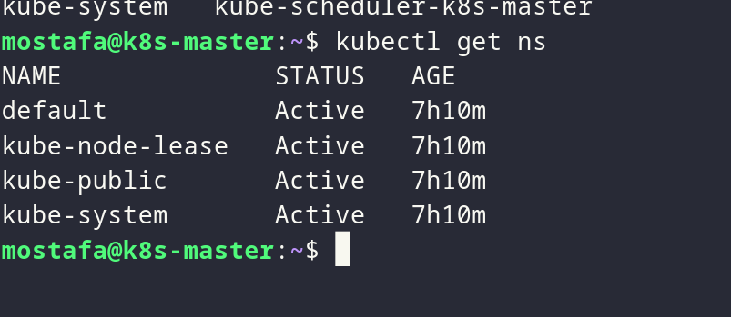

# Lab 9 - Kubernetes Basics

## Overview

Creating and managing basic Kubernetes resources using YAML manifests.

## Proof

### 1. Apply manifests

*Applying YAML files to create the required resources.*

### 2. List pods

*Checking that the pods are up and running.*

### 3. Describe pod

*Viewing details, status, and events for a pod.*

### 4. Check services

*Listing Kubernetes services to see how the app is exposed.*

### 5. Access the app

*Testing the app to make sure it's reachable.*

### 6. Verify all resources

*Confirming all created resources are running correctly.*
